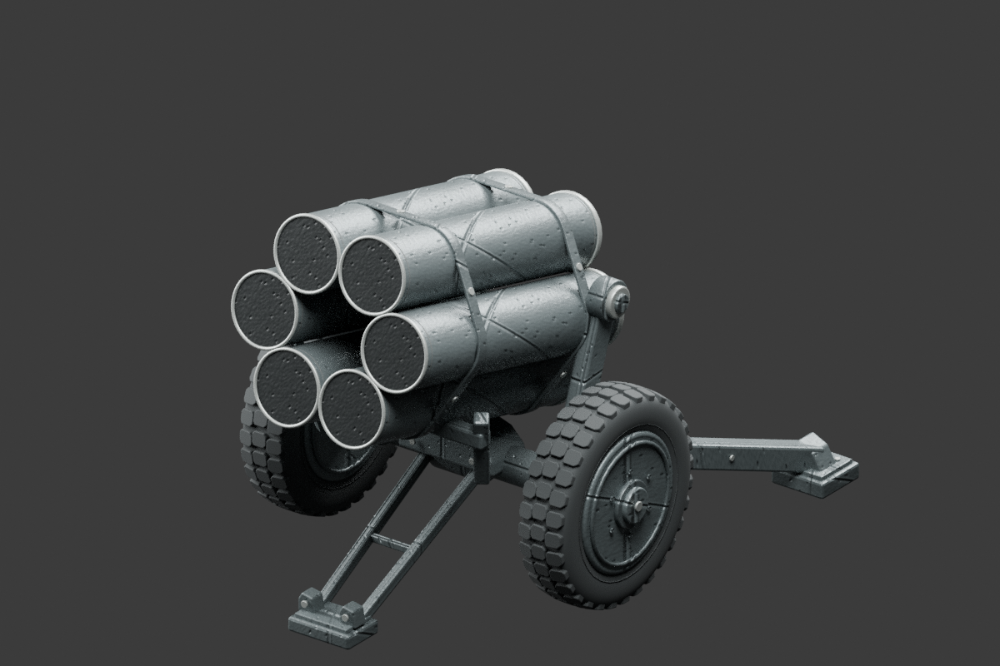

# DOT · 装备模型展厅

此前 dot / PGF 游戏美术资产的独立仓库。已迁入 **11 款可运行模型**的源码、可恢复源模型、材质依赖、原始说明和真实渲染；提供卡片展厅、旋转/缩放、原生参数/材质、实际能力对应的预览演出、配方导入导出和静态 GLB 下载。

**Kar98k 是新增优先项，但当前只到准备阶段，未生成模型。** Blender MCP 现已在任务目录恢复并通过真实只读握手；概念图请求仍被图像工具安全审核拒绝；详情见[准备与实际阻塞](preparation/kar98k/README.zh-CN.md)。没有虚假模型或下载占位。

## 本地运行

需要 Node.js 22.12+（本轮使用 Node 24.19）。首次使用由运行者安装锁定依赖：

```sh
npm ci
npm run dev
```

打开终端显示的本机地址（默认 http://127.0.0.1:5173）。生产模式：

```sh
npm run build
npm run preview
```

展示页读取本仓库资源，不依赖 PGF 工作目录或 CDN。静态产物位于 `dist/`。**未发布 GitHub Pages、未修改仓库可见性。** 本轮使用环境已有的依赖，迁移阶段未安装 Blender MCP、Firefox 或新 npm 包，仅生成 package-lock 元数据；后续获明确授权后已在任务目录恢复固定 Blender MCP，见下方工具恢复说明。仓库不包含 node_modules。

## 已迁入模型

所有默认 GLB 都是本轮从原始定义实际生成、相同种子重复生成校验并独立回读的文件；不是下载占位。动画为浏览器预览演出，导出 GLB 均为静态、0 clips。

| 模型 | 本轮默认 GLB 三角面 | 预览能力 |
|---|---:|---|
| [参考图四轮装甲车](public/models/reference-armored-car.glb) | 107,826 | 轮组移动、分解预览 |
| [履带重型臼炮](public/models/tracked-mortar.glb) | 109,900 | 履带移动 |
| [古斯塔夫](public/models/gustav-visual-prop.glb) | 146,012 | 牵引展示、艺术烟云 |
| [柴油机车](public/models/diesel-locomotive.glb) | 86,716 | 轮组移动 |
| [旧悍马 v1](public/models/armored-4x4.glb) | 200,996 | 轮组移动；原外观复核未通过 |
| [Nebelwerfer 41](public/models/nebelwerfer41-visual-prop.glb) | 109,516 | 固定外观、艺术演出 |
| [QF25](public/models/qf25-visual-prop.glb) | 102,680 | 牵引展示、局部烟云 |
| [Flakzwilling 43](public/models/flakzwilling43-visual-prop.glb) | 84,712 | 固定底架朝向展示、艺术烟云 |
| [BM-13N / US6](public/models/bm13-us6-visual-prop.glb) | 129,976 | 仅静态 |
| [QF17](public/models/qf17-visual-prop.glb) | 50,776 | 仅静态 |
| [Land Mattress](public/models/land-mattress-visual-prop.glb) | 48,036 | 仅静态 |

参数与材质来自原模块 schema；固定作者资产的部件/比例/三档不等于在线重建几何。非精确历史复原，隐藏面与部分细节含艺术推测。旧车等跨年代资产按“此前 dot 资产”保留，未将全部模型宣称为二战装备。

## 真实画面

以下 N41 图是**本轮默认导出 GLB**在 Blender Cycles 的实际导入渲染，普通 Blender 离线渲染，不是 MCP 建模、不是概念图、不是 Firefox 截图。[脚本](scripts/render-existing-asset.py) / [日志](evidence/n41-render.log)。



其余卡片采用已恢复的历史真实模型渲染 / Firefox 截图。例如：[BM13 hero](modules/bm13-us6-visual-prop/evidence/renders/BM13-B6-PGF-hero.png)、[QF17 三视](modules/qf17-visual-prop/evidence/Q6-final/QF17-Q6-PGF-three-view.png)、[Land Mattress 三视](modules/land-mattress-visual-prop/evidence/final/LM-L3-PGF-three-view.png)。这些历史证据不等于本轮新展厅浏览器验收。

## 验证状态

- **通过**：独立 Vite 生产构建；88 项统一工作台 Node/Three 生命周期与动画回归；11 款实际默认生成、同种子 GLB 字节一致、PGF 及独立 GLTFLoader 回读和实际 PNG 解码。各模型均有法线和 UV，有限属性，未发现精确零面积三角面；此检查不声称全历史相似度或完整拓扑质量认证。独立回读资源显式释放。
- **通过**：生产服务所有产物 HTTP 200 与逐文件 hash 回读，11 个默认 GLB 下载路径，BM13/QF17/Land Mattress 九个源档位真实 hash。源 GLB 字节保持不变，修复三模块原动态资源 URL 在独立生产打包中遗漏的问题。
- **通过**：N41 固定 GLB 的本轮真实离线渲染。初次渲染因此 Blender 无 OpenImageDenoise 失败，关闭不可用降噪后成功，失败日志保留。
- **未运行**：新展厅 Firefox 交互、实际浏览器下载、旋转缩放、PC 缩放、GPU/Worker 释放及截图验收。系统及已有 Playwright Firefox 路径没有 Firefox；未安装、未改用 Chromium。历史 PGF 浏览器报告仅作来源证据。
- **未运行**：CodeGraph（无工具/索引）；全 PGF 构建与测试（不属于此独立仓库）；Kar98k 建模及其全部模型验收。
- **已保留的失败**：最初验证脚本 ESM 无法解析环境既有 canvas 包，改用 Node createRequire 后通过；离线 lock 元数据缓存不足，改为正常网络元数据解析后成功，没有安装新依赖。构建有较大 chunk 提示，源资产首次加载需要时间。初版 lock 继承本机依赖链接，已重新生成并核对无本地链接。全量导入的 diff whitespace 检查报告历史日志/补丁的既有空白；保留源字节，新增源码单独检查通过。

[模型回读报告](evidence/model-validation.json) · [88 项测试日志](evidence/node-tests.log) · [构建日志](evidence/build-final.log) · [生产资源报告](evidence/production-resource-report.json) · [Firefox 未运行记录](evidence/browser-status.json)

复查命令：`npm test`、`npm run validate`、`npm run build`、`node scripts/check-production.mjs`、`node scripts/audit-provenance.mjs`。验证脚本会重新生成 `public/models/`；保存本轮种子 `dot-gallery-20261021`。

## 遗漏与暂停项

四张无明确再分发许可记录的原始观察输入图未复制，模型、真实渲染与运行材质不受影响；[记录](provenance/excluded-reference-inputs.json)。

- Flak18/36 F6：Library 包未迁入；既有代理 403 未解除，本轮没有重试下载或重造。
- K5：暂停。仅恢复[原始概念参考资料](archive/k5/STATUS.md)；目录中声称的 K2 模型源码没有从已检查 Git 分支恢复，不能据目录文字标完成。
- Long Tom：暂停，已检查分支未找到可恢复模型；需要原备份身份，才可继续归档。
- PaK40、75 mm M1A1：尚未建模，无模型卡片。
- Kar98k：已独立制作外观初样 WIP，见下节；原概念多视图及子型核验未完成，未通过用户或 Firefox 验收。

## 来源与独立性

基线 [PGF ab321682](https://github.com/BitDG/PGF/commit/ab3216828c8e289f0e118a96cfbd7d05f1a0576c)。只提取目标资产目录和实际运行依赖，不修改、删除或移动 PGF 原件。原 PGF 本地 checkout 保持原 HEAD 和干净工作区。未复制整个 PGF 或用户私人配置。

[原始资产工作台说明](modules/dot-model-generator/README.zh-CN.md) · [逐文件来源](provenance/import-manifest.json) · [迁移修改清单](provenance/migration-deltas.json) · [依赖图文件清单](provenance/runtime-dependencies.json) · [分支核对](provenance/branch-heads.json) · [来源与许可](THIRD_PARTY_NOTICES.md)

保留的历史模块源码/测试/证据可能引用当时完整 PGF 的开发脚本；本仓库独立入口为 `gallery/main.js`，独立运行依赖已打包核验，`npm test` 只运行本入口相关的 88 项回归。原全应用导航集合测试没有伪称在独立展厅通过。来源未统一授予新的开放许可。

## 后续工具恢复（2026-10-21）

[固定版本恢复步骤与边界](scripts/tooling/README.zh-CN.md) · [真实 MCP 握手回执](evidence/tooling/mcp-verification.json)。mcp-for-blender 2.1.9 + Blender 4.3.2 已通过初始化、工具发现、插件状态和场景只读调用；安全模式有效，遥测和外部服务关闭，结束后进程/监听退出。Firefox仍因无离线包、此前官方CDN代理403未解除而未安装；Kar98k模型阶段继续暂停，独立美术准备已补齐。

## 固定 GLB 图集与导出修复（2026-10-21）

[11 款真实渲染图集](gallery/fixed-glb-atlas.png) · [逐款 PNG](gallery/renders) · [MCP 调用与渲染脚本回执](evidence/fixed-gallery) · [图集校验](evidence/fixed-atlas-validation.json)。展厅现以可下载的同一固定 GLB 作为全部卡片图像来源；逐款独立取景，不代表实物比例比较。通过真实 MCP 调用 Blender 4.3.2 渲染，未重建几何、未改默认 GLB。N41 首次取景的牵引端靠近边缘，检查后扩大安全取景重渲。

修复 11 个静态参数 JSON 缺少原生导入格式标识的问题，卡片新增参数下载、实际三角面数、GLB 动画数及 SHA256。所有固定 GLB 均无内嵌动画；工作台演出能力单独标注。[参数/材质契约检查](evidence/gallery-contracts.json)逐款使用真实原生读取器导入参数，并实际生成、导出、独立回读不同材质变体；11/11 通过，默认模型字节未改变。初次格式失败日志保留。

Kar98k 完成[馆藏参考与部件美术核验记录](preparation/kar98k/reference-audit.zh-CN.md)、无制造尺寸的外观参数草案、两套配色草案及真实材质候选 hash；[9 项准备检查](evidence/kar98k-preparation-checks.json)通过。馆藏文字可读，照片获取被代理拒绝，未重试；尚未确认外观子型。原概念图请求的拒绝未被重试或绕过，规定的原创多视图前置项仍未满足，因此没有新 Kar98k 模型或模型实渲。

[Firefox 离线制品检查说明](scripts/tooling/FIREFOX-OFFLINE.zh-CN.md)与只读校验脚本已加入：需管理员提供官方 Playwright Firefox 144.0.2/revision 1497 Debian13 x64 制品及独立可信 SHA256。当前只有参数拒绝负例与语法检查通过；真实制品校验、安装、Firefox 交互验收均未运行。没有重试下载、改代理或改用其他浏览器。

本轮构建见 [日志](evidence/build-fixed-gallery.log)，生产资源报告已更新。附加复查：`node scripts/validate-gallery-contracts.mjs`、`node scripts/validate-kar98k-preparation.mjs`、`python scripts/build-fixed-atlas.py`。后者仅依赖已有 Pillow，并核验固定模型/渲染对应关系后拼接图集；不会生成模型。

## Kar98k 独立外观初样（后续阶段）

不依赖 Firefox，已通过真实 MCP 制作 [Kar98k 风格外观 WIP](assets/kar98k-wip/README.zh-CN.md)，保存打包贴图的 `.blend` 与固定 `.glb`，并从该 GLB 回读生成 [单张真实 hero 渲染](assets/kar98k-wip/hero.png)。展厅新增单独 WIP 入口和源文件下载，不混入原 11 款迁移资产。无内部机构、孔道或真实制造尺寸。

这是用户要求独立推进后调整的制作顺序；原概念三视/六细节请求没有重试或用其他工具重现，不能声称原流程完成。Firefox 仅用于后续网页交互验收。外观初样的检查与真实 MCP 回执见 [evidence/kar98k-wip](evidence/kar98k-wip)，历史准备记录保留并标注更新时间。

最新流程更新：用户已取消 AI 原创概念多视图前置，改用真实外观参考。本轮新增瑞典陆军博物馆照片来源与公共领域许可核验，但像素请求被代理拒绝，未重试；未获得同一物件完整真实三视。详见 [参考缺项](preparation/kar98k/reference-update.zh-CN.md)。新模型提供真实模型正/侧/严格顶视与六外观细节渲染，以及木色、金属粗糙度、无量纲比例和背带的预览控制；仍是美术推测 WIP，网页交互待 Firefox 实测。

## 2026-10-22 同一 Kar98k WIP 的材质改进

完成原创纵向木纹、木材微法线和 UV 对齐；新增有边界校验的实际 MCP 生成参数（无量纲比例、木材粗糙度、背带开关）。仍为同一资产，未重做 11 款旧图集。固定 GLB 的全部 10 张实渲与 .blend 同步更新。参考多视照片像素仍不可获取，未改变外轮廓或声称历史准确。见 [当前资产说明](assets/kar98k-wip/README.zh-CN.md) 与 [本日证据](evidence/kar98k-wip/2026-10-22)。当前额度没有可读取入口，未调用收费生成服务；Firefox 网页验收继续待补。

## Kar98k 外形精修阶段

同一资产已重塑木托连续曲率、握持处收腰、护木渐缩与金属/箍带层次，并细化背带曲线和接缝。材质颜色保持不变；[前后对比](assets/kar98k-wip/comparison/before-after.png) 使用相同相机灯光检视几何变化。展示档与标准档有真实几何差异，可在原 WIP 入口切换和下载。见 [当前说明](assets/kar98k-wip/README.zh-CN.md) 与 [本阶段证据](evidence/kar98k-wip/refinement-2026-10-22)。未取得新的可靠多视像素，不宣称历史精确复原；Firefox 和 Library 仍待解除既有阻塞，本轮没有重试其拒绝路径。
