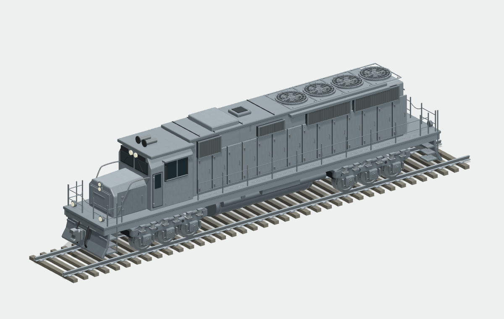

# 柴油机车 · 参数化外观模型

源图启发的美式柴油机车游戏外观，不声明具体历史型号或工程测量精度。长机罩、短鼻驾驶室、两组三轴转向架（12 枚金属轮）、侧走道与护栏、屋顶风扇、排障器及车钩均为实际模型。默认四风扇是统一艺术配置，不代表原型考证。

## 实际渲染预览

1.2.1 中档固定 GLB 的实际 Three.js 渲染（diesel-art-1，原色）。
同一模型的正交三视：[正视](evidence/three-front.png) · [侧视](evidence/three-side.png) · [俯视](evidence/three-top.png)。

## 使用
标准 manifest 自动发现，单一 definition.mjs 持有 schema/defaults/presets/UI 和 canonical generate。worker.js 复用共享 data-workbench Worker，workbench.js 复用共享表单/Three 预览/静态 GLB 导出。未修改共享注册表、MCP 分派或其他生成器。

- 车身相对长宽高：0.85–1.15
- 两轮组间距、圆轮视觉倍率：0.85–1.15
- 风扇数量：2–5，自动调整圆罩半径避免沿车长挤撞
- 格栅/铆钉细密度、磨损：0–1
- 原色、漆面色、裸钢色、坦克已有迷彩/环境/规模参数
- 轨道、栏杆、格栅、铆钉开关
- 灰钢、工业黄、干净、旧蓝、低档五预设

尺寸改变通过运行时部件重组生成，未用一份整车静态 GLB 冒充参数化。车轮圆形使用统一缩放；两轮组和 12 枚轮保留独立语义。车体底部按轮半径、轨道高度、车高重新定位，三档均验证车壳与走道接触。风扇圆罩也不随长宽比例拉成椭圆。

## 来源
详见 SOURCE-MATRIX.md。PGF rule-kit 规则几何、bridge 的轨道描述、curve-infrastructure 栏杆、坦克公共可移植漆面均实际复用。新增驾驶室、短鼻、三轴侧架、弯曲排障器和钩形外观通过真实 Blender MCP 制作。铁路轮是经作者确认冻结的 Gustav Blender MCP 独立原型，保存来源 SHA，无运行时依赖其生成器。编辑源 .blend、三档 GLB、zlib 无损运行时网格、源脚本和 MCP 回执保留。

只有 armorPaint 角色使用坦克漆面；玻璃、橡胶软管、金属踏面/钢轨、灯具各自保持独立。PGF 单位容器为米、Y-up，实际数值为未测量的艺术比例。共享 ORM 的 AO 通道为常量，不声称烘焙几何 AO。

## 性能与语义
同 owner + material 的不动规则零件合批，metadata.components.sourceParts 保留原件名称/来源/三角范围；不同轮组不跨 owner 合批，车轮保持独立。低/中/高是重新生成的几何档位，并非自动距离 LOD。

1.2.1 当前统计：低 23,884 三角/47 draw；中 86,716/48；高 149,228/48。显式上限分别为 95k/120、220k/140、420k/160。中档实际 GLB 3,131,440 字节。统计见 evidence/runtime-acceptance.json；D3 的 1.1.2 旧统计仅属于历史阶段。

## 本地验证
在任务 workspace 执行：

    node --loader ./pgf-vehicle-test-deps/loader.mjs --test PGF/modules/diesel-locomotive/tests/core.test.mjs
    node --loader ./pgf-vehicle-test-deps/loader.mjs PGF/dev/diesel-locomotive-acceptance.mjs
    node --loader ./pgf-vehicle-test-deps/loader.mjs PGF/dev/diesel-locomotive-worker-test.mjs
    node --loader ./pgf-vehicle-test-deps/loader.mjs PGF/dev/diesel-locomotive-export.mjs medium
    node --loader ./pgf-vehicle-test-deps/loader.mjs PGF/dev/diesel-locomotive-preview.mjs

独立 loader 使用任务已获授权的 Three 0.180.0、fflate、ajv、canvas1.0.9；没有重新安装依赖或改 package lock。preview 构建使用 Vite 8.1.5，与仓库声明 8.3 不一致，因此不作为完整生产构建通过声明。

## 验证状态
- 已通过：真实 Blender MCP 五部件三档生成；Node 十六项测试（含可见深度与迷彩 UV 尺度）；13 参数/预设变体；实际 GLB→readGLB→Three GLTFLoader（含纹理解码）；零退化/UV/单位法线；轮子圆度和接触；部件来源/语义/socket；多次 Worker 一致性/中途终止/新 Worker 恢复；原色与裸钢身份；独立预览构建
- 已通过：D3 实际整车 Blender MCP 回导和实渲；镜像零件面绕序修复；裸钢/玻璃/橡胶/灯具迷彩隔离；maxTriangles=1 和预先 abort；极端车长/轮径的轮间距及油箱长度适配
- 已通过：D6 同一模型 SHA 的 hero/近景/严格正交三视；原生 .blend 实际重开；三视方向/相机中心/像素投影比例数值审计；五张实际 Firefox/Three 预设 PNG 及像素检查
- 已通过：清晰同 SHA Three hero/三视；真实 Firefox 参数/预设/材质切换、取消恢复、GLB/配方导出导入；实际浏览器 GLB 的独立 Node/Three 解码；idle delta=0、显式 dispose/Worker terminate
- 已通过：1440×900、1600×900 实际 Firefox RDM 全幅 PNG，模型、完整右栏、导出及配方按钮均可见；保留旧桌面裁切图为历史记录
- 950×900 完整界面与滚动/色值已实看；宽屏证据最终状态见 evidence/firefox-acceptance.json
- 未运行：产品交互 GIF（原生工具无录制 API，不用静态图循环冒充）；完整生产构建、整个仓库测试、PGF stdio MCP 全链（所需完整依赖未装）
- 参考 TOP v2 曾含斜视；已换 v3，但生成图片仍不当作标定蓝图。最终三视必须由同一实际模型正交相机产生并保留姿态/投影/模型 SHA

## D3 阶段修订
1.1.2 细化底部油箱/箍带/侧管、前鼻灯壳/检修门/把手、转向架/轴箱层次、嵌低风扇罩和屋顶分区。大尺寸细节来自几何，不把 Cycles 采样噪点当磨损。漆面复用坦克材质并在本模块衰减法线/明暗压纹；不修改共享材质源。

镜像静态零件合批时同步反转三角绕序，世界位置和三角数不变；逐面法线/绕序已回归。轮径增大或车长缩小时，两轴视觉间距自动保持正间隙，油箱在两内侧轮之间自适应。仍为一般艺术比例，未声明工程装配公差或全模型机械碰撞求解。

历史 D3-hero.png 对应当时 1.1.2 模型（已冻结于 D3 阶段 payload），SHA256 689932515fc2aa2614b473760d4ef50cbc66e831c48860332340d1ad18d5e716。回执 D3-final-hero-mcp-receipt.json：62,412 三角、48 mesh、0 非有限坐标，32 samples，4 CPU threads，denoise=false。

## 1.2.0–1.2.1 结构细化记录
用户最后确认直接采用 PGF 材质，因此实际运行继续使用 PGF 可移植漆面，不导入独立 Blender 材质实验。已完成的九张原生烘焙和 editable .blend 保存在 assets/native-surfaces，标记未采用；源实验留档，不作为当前材质来源。没有导入或复制 truck 模块几何或 shader。

结构改为中高档真实螺旋弹簧、上下弹簧座、刹车块/吊杆；格栅四边厚框、斜叶片及凹入支撑；窗压条/门铰链、灯座和连续弯接扶手。低档省略螺旋与局部装配，中高档分段不同，仍按同 owner/material 合批。只作外观层级，不声称车辆悬挂或制动仿真。D5 与 D3 使用相同灯光和 hero 相机方案用于中景对照。

1.2.1 改为外露弹簧座及轴箱两级深度，检修门加实体折边并同步调整附件接触位置。当时几何验证：12 项完整回归加 1 项定向外露深度测试通过、13 变体 GLB 回读通过、Worker 测试通过；中档 86,716 三角 / 48 draw，高档 149,228 / 48，低档 23,884 / 47。最终视觉与浏览器验收仍须以独立回执为准。

## 当前几何证据
1.2.1 中档 GLB SHA256：bb62ac17a9e3b57d581cc52aff70495fdd1b52973b5c60c6f035d737e40f72cc。
D6-hero.png、D6-bogie-detail.png、D6-side.png、D6-top.png、D6-front.png 均由此文件经真实 Blender MCP 导入后渲染。D6-projection-audit.json 直接从回执提取：同一中心，正交相机，垂直顶视方向 [0,0,-1]，三视同约 0.0184 单位/像素。Cycles 32 samples / 4 CPU threads / no denoise，颗粒是采样噪声，不计作细节。

assets/blender/diesel-pgf-D6-reviewed-scene.blend 已实际重开，49 个 mesh（包含地面），三张 256×256 贴图全部打包，零非有限坐标。参考图不是标定蓝图，当前模型不声称某个准确车型、工程尺寸或量化的高相似度。

## 可选迷彩 UV 修正
Firefox 发现旧逐门 0–1 UV 把数字迷彩拉成重复竖条，已在本模块的非 original 分支改为世界艺术单位盒投影。默认每 4 艺术单位一贴图周期，camoScale 直接写入 UV（有效周期 4/camoScale），共享坦克 painter 使用 scale=1，避免重复缩放。门板与油箱同向表面使用同一坐标尺度和相位；转角存在盒投影轴接缝，不声称曲面无缝测地展开。只处理 armorPaint；玻璃、橡胶、裸钢与灯具的 UV/材质不变。

16 项测试、13 变体和 Worker 回归通过。修正后默认原色重新导出的 SHA 实测仍为 bb62ac17a9e3b57d581cc52aff70495fdd1b52973b5c60c6f035d737e40f72cc，因此默认实渲、正交图与五张原色预设 PNG 保持有效。迷彩环境选项沿用共享语义：auto 根据环境选图，显式图案不因 environment 改变其既有调色板。最终浏览器复核以 Firefox 回执为准。

实际工作台下载的迷彩/原色 GLB 使用 UI seed=pgf-components-1，文件 SHA 分别为 a8e034156ff384debaecd04f2b5639cee50ea6b4f31cc26b0bcaf44863d9e54b 与 9e135ac02a5cca70e8b60cb8acba5da106b7223c723c5e02963e4f16f3afc835；不将其 SHA 混同于清晰图及 D6 Blender 图的 diesel-art-1 / bb62 源文件。两份实际下载均经 readGLB、AssetIR 验证及真正 GLTFLoader/PNG 解码，面数/部件/插槽/UV 状态正确；报告 browser-glb-readback.json。导入 GLB 审核页曾保留旧预设标签，已改为 imported-glb 身份与真实嵌入 recipe，Firefox 已验证；原错误标签回执保留为历史证据。
