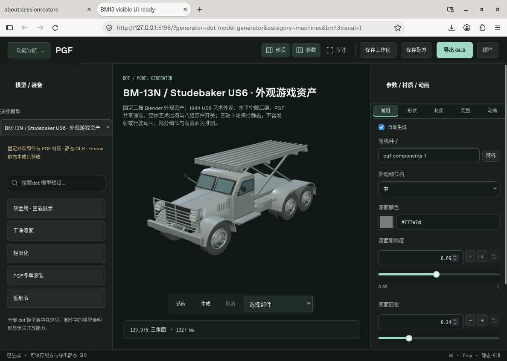
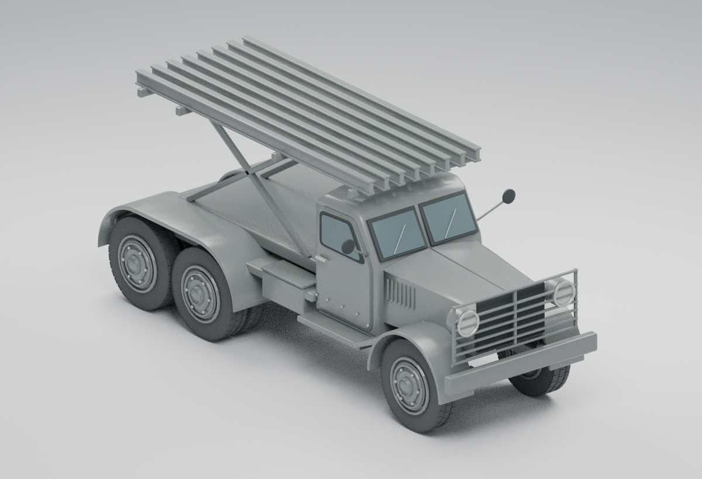
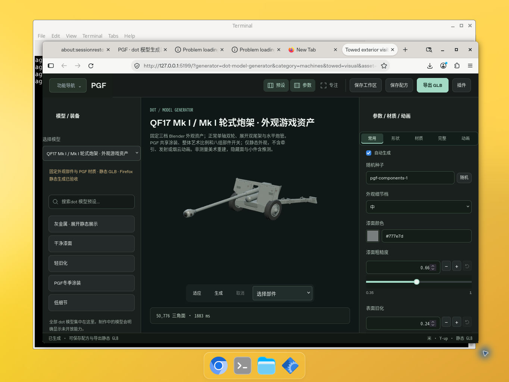
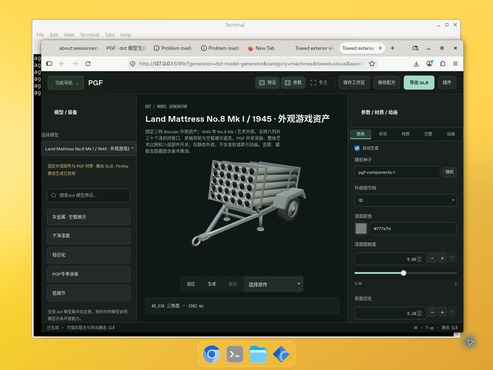
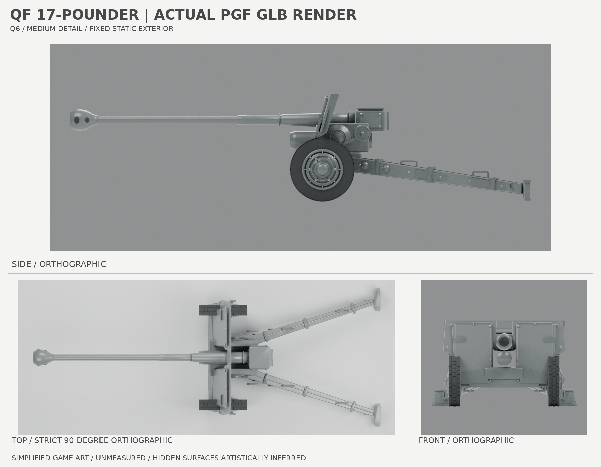
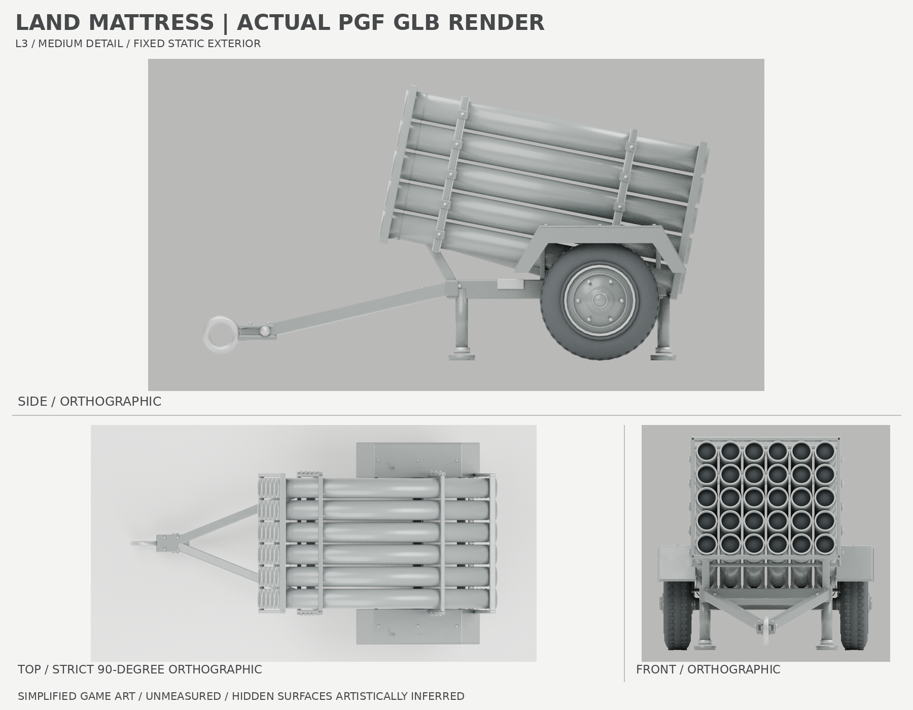

# dot 模型生成器 D4 · 统一静态资产与动作预览

此模块在真实 PGF 工作台内提供一个模型选择器、一个三维视图、一套参数/材质/动画页签，以及统一配方和 GLB 操作。D2 不再挂载子工作台。原模型的定义、参数含义、材质生成、Worker 和静态 GLB 导出算法保持不变。

## 从 PGF 打开

主页「功能导航」→「载具与装备」→「dot 模型生成器」，再在左侧「选择模型」切换资产。也可在当前 PGF 站点打开 `?category=machines&generator=dot-model-generator`。主页支持搜索目录内模型的名称或 ID，例如 `QF17`、`Land Mattress`、`BM-13`；进入后右侧页签提供所选模型自己的参数与材质。

当前目录有 11 个可运行后端和制作中的 K5。Flak18/36 F6 冻结包尚未取得，未注册、未接入，也未完成统一入口验收；它与已接入的 Flakzwilling 43 是不同模型。QF17、Land Mattress、BM-13 为静态资产，不提供动画。下文的 Firefox 记录是对应阶段历史证据，不代表此次导航调整已重新通过浏览器验收。

## 已实现与验收边界

- 原五个后端保持不变；新增 nebelwerfer41-visual-prop 标准定义/Worker 适配。N41 1.0.1 已通过 30 项真实统一 Firefox 检查与 50 项纯 Node/VM 回归
- 切换复用同一个 `createPluginPreview`，清理前一个资产并取消旧 Worker/上传/导出；未完成参数不会写入成功配方
- 原模型 PGF.ComponentRecipe 保存和导入保持 generator/params/seed；PGF.DotModelRecipe 以 assetId 分槽保存，禁止跨模型 schema 误用
- 材质来自原始定义，完整页签可访问所有原参数；旧悍马与新版装甲车仍是独立 ID
- K5 仍不可生成、调参或导出；选中后清空旧模型。N41 使用固定 Blender 外观源，提供 PGF 共享漆色/粗糙度/风化/迷彩与 5 组部件可见性、静态 GLB；不提供在线几何重建
- N41 的 N4 发射演出通过 N6 1.0.1-hosted 接入统一工作台，与静态外观共用画布和 tick；静态 GLB 不包含演出。静态资产与动画的验收分别记录
- D2 运行检查点：48 项 Node/VM 回归、10 次真实后端生成/GLB 回读、51 项 Firefox 实际 PGF 工作台检查全部通过。Firefox 157.0.1 使用原 Vite 配置和真实模块，验证五模型连续切换、参数/材质、原配方和工作区回读、实际下载 GLB 的独立 GLTFLoader 回读、快速切换、不可运行模型清空、静态空闲/隐藏停绘与销毁
- PC 原生界面在约 963×815 和 1188×848 窗口检查；不是移动端验收。WIP 切换后 GPU 几何/纹理均为 0；销毁后 canvas/生成 Worker/导出 Worker/对象 URL 清空且 render Worker 终止，终止后的 GPU 计数为历史值，不据此声称再次读取到了 0
- 已知环境提示：Firefox 不支持 KHR_parallel_shader_compile 时走正常回退；原应用 favicon 请求 404。检查期间没有脚本或 shader 错误。首次空闲测试过早取样的失败记录保留，修正测试测量等待最后一次失效帧后，两次实际运行通过

## 导航集合与兼容性

成员的 generator manifest 添加通用 `workbench.collectionId: "dot-model-generator"`。SDK 只认识通用集合关系，不硬编码 dot。
`projectGeneratorCollections` 仅投影前台导航：保留所有原始 routes/getGenerator/manifest/MCP，旧直链继续进入原模块。子模型标签和 ID 可搜索到父卡。缺少父入口或出现循环关系时不隐藏工具。

## 新增后续 dot 模型

1. 按 PGF GENERATOR-FOUNDATION 添加独立 definition/schema/Worker 与稳定 assetId；保留原始算法与导出
2. 原生 workbench manifest 加 collectionId，前台就不出现第二张卡；没有 workbench 的美术源不要伪造注册
3. 在 catalog.mjs 加来源、阶段、能力、验收状态。未运行通过的模型先标 source-only，各能力写 unavailable
4. 达到接入条件时，在 backends.js 和 definition.mjs 添加原生后端，使用同一共享 viewport 与 schema 控件，禁止再次嵌套工作台
5. 运行新增/现有测试，完成 Firefox 连续切换、参数/材质、配方、下载与回读、隐藏/恢复、资源释放后再升级验收状态

## 源码结构

- controller.mjs：当前 D2 单视图生命周期、原配方分槽与过期任务保护
- backends.js：原五模型与 N41 的 Worker 和 definition 适配，无模型算法分支
- schema-controls.mjs：原 JSON schema 值的共享控件渲染
- workbench.js：固定视图/面板与下载 URL 所有权
- session.mjs 与 session.test.mjs：D1 子工作台托管兼容源码和历史回归，D2 工作台不再引用
- dispatch.mjs/definition.mjs：Node/MCP 通用生成路径，资产 provenance 与材质不改

在完整 PGF 源树运行：

`node --test modules/dot-model-generator/tests/*.test.mjs`

测试使用纯 Node 和显式 VM renderer/Worker 模型；它们不等价于真实浏览器/WebGL 验收。K5 manifest 差分仅能随完整 K5 模块之后发布，不能单独创建一个不可加载的注册项。

## D3 增量边界

D3 基于不可变 D2 运行检查点；发布清单以该检查点逐文件 Git blob 为基底。N41 模块、此入口增量、独立 N4 演出分别冻结。运行检查点的生成不代表 GitHub 发布完成。

N41 实际下载 GLB 独立回读：355 mesh、109516 三角面、3 张实际解码 PBR 纹理、6 个暗色封闭管端、0 动画。5 组部件开关、PGF 冬季迷彩、错误草稿/取消保护、模型回切与静态 GPU 清理/销毁均通过。初次测试的枚举索引输入和暗色阈值设定问题记录保留；修正测试遵循真实 schema 枚举和固定美术源颜色范围，未以修改产品或原艺术资产来掩盖失败。

## D4 统一动画宿主（2026-10-12；含最终 F2c）

五种旧模型接入同一主线程 Three 视图的轮组/履带/轨道移动预览。Gustav 是牵引展示；N41 无自行行走。Gustav 开火与 N41 N4 发射使用同一 scene/canvas/renderer 和现有 host tick；动画模块不创建 RAF、renderer 或第二画布。暂停、停止复位、倍率和模型近景/完整演出取景均在同一动画页签。默认模型近景，完整离屏美术轨迹范围由用户选择。

- 最终 89 项 Node/VM/实际 Three 集成测试通过；105 项真实 Firefox 157.0.1 检查通过
- 六模型动画中实际下载 GLB 与播放前字节一致，并由独立 GLTFLoader 回读：无动画 clip
- 失败编辑与取消保留上一成功资产及其 runtime；成功替换才销毁。履带、Gustav、N41 均覆盖
- 显式隐藏与恢复首帧不追赶；播放经 preview.play 重置时钟。document visibilitychange 也清时间基线，dispose 移除监听
- 连续三轮 Gustav/N41 演出、切 WIP 后，所有自有对象/纹理/绘制释放。Three 0.180.0 的 Sprite.js:11,68–92 为全实例共享几何；renderer 预热后稳定保留 1 个缓存，不冒称绝对 0。最终 renderer 强制 context loss、canvas/worker/object URL 清空
- 首轮 GPU 清理测试错误要求共享 Sprite 缓存为 0 的失败记录保留；修正检查补上对象身份和六次交替稳定性，不销毁其他使用者借用的共享 geometry
- 两个 GIF 来自固定机位 Firefox 原生窗口连续播放采样，按记录的真实抓帧间隔编码；没有插帧或离线合成。独立 2 秒 Gustav 帧是 seek(2) 后真实 GPU 暂停检查，和连续 GIF 分开标注

边界：只提供艺术预览，导出仍是静态 GLB。Gustav 最终 F2c 烟云从同一炮口出生，渐开为不同大小多瓣并消散；22 帧原生连续实录逐帧检查通过。此前 F1/F2b 候选仅保留为历史证据。美术外观并非精确历史复原。固定姿态的 seeded 重播可复现；移动同时开火的出生点按 host 帧末姿态读取，不承诺不同 dt 分块的空间点逐值一致。K5 仍 source-only，不开放参数/生成/动画/导出。旧悍马 v1 外观复核未通过状态保留。

本检查点以 D3 逐文件 Git blob 为基底，包含 M1a、N6 1.0.1-hosted 和 F2 0.2.0-firefox 最终源码（index SHA256 f6325a59f90eb9826396066e02e47dc829a48670a3f2af6b77cd8db99ec58cd2）。GitHub main 仍为 12f6836；D2 ref 更新被取消，此冻结并不代表已发布。

最终连续 GIF 的约 0.32 秒抓帧间隔未保证捕获约 75ms 短亮部；不能称每个瞬态均有照片。最终 105 项 Firefox 报告 SHA256 为 978b84bd51d2a42c845db66ad0ae9333491c202bd375c801ebe7fbd88967a1a1。此 README 是原 D4 冻结后的文档 delta，运行逻辑没有随本文改动。

## I2 最终 QF25 Q2 与 Flakzwilling F2（2026-10-12）

两模型固定作者资产均为 v1.1.0，通过同一 canvas / renderer / host tick 接入，不增设工作台。QF25 牵引滚动与局部烟云；Flakzwilling 三脚底架固定、无行走轮，朝向展示与双局部烟云明确属于游戏美术演出。静态导出无演出，材料复用 PGF metal-finish 和既有迷彩。

- QF25 Q2：Firefox 51/51；Flakzwilling F2：Firefox 50/50。实际单视图、原生 schema、部件/比例/三档/贴图、失败编辑/取消保留旧模型、播放时静态 GLB 字节一致、GLTFLoader 回读、三轮切换释放及最终 renderer dispose 均通过
- 127 项统一模块与两模型/两 runtime Node 测试通过；独立统一 workbench Vite 构建通过，六个最终源 GLB 产物逐字节 hash 相同。此为指定入口构建，不冒称全仓构建
- AA 首轮测试将装饰 Handwheel 误分类为行走轮，失败报告原样保留。修正测试只匹配 wheel/tire 独立节点词后完整重跑；产品与源模型未为测试改动
- Three 共享 Sprite geometry 有界缓存身份核验并三轮稳定为 1，textures/drawCalls 均 0；不释放其他使用者借用的资源
- 实际导出以各自测试 seed、recipe、hash 为准，与美术审阅出口独立追溯。短 GIF 是原 renderer 暂停 seek 采样，不声明为连续实时时序录像
- CodeGraph 在此环境不可用，未运行。QA 同源固定文件白名单工具变更仅用于测试回执，不是 PGF 运行依赖；未改变网络或安全配置

证据位于 qf25-q2-evidence 与 flakzwilling-evidence。K5 继续 source-only。

### I2 默认近景补验

QF25 / Flakzwilling 默认近景以可见静态作者顶点的实际投影宽高求距，限制轴约占画布75%，保留防裁剪边缘；模型比例、父变换及重新生成均纳入计算。只适用于已核无skin/morph/instancing的六档静态作者GLB。完整演出和其余六模型仍使用原包围球适配，host拥有相机、裁剪、resize与时钟。Firefox另14项取景检查通过：两模型默认实际宽均75%，完整范围/近景往返、重建比例边界、切旧N41及回切正常。首次仅测中心边距导致QF实际宽61%的失败记录保留，已改为真实投影总宽计算。

最终合并Node130项（含三项取景测试）无警告通过；AA测试夹具的旧纹理序列化警告保留在历史log，最终版本采用真实PNG解码与对象/参数/字节快照。

## 已验收的 QF25 Q2 / Flakzwilling F2 实际画面

以下是统一工作台内的真实 Firefox 截图，默认模型近景按实际投影约占画布限制轴的 75%。两个模型共用原有画布、renderer 和宿主时钟。

### QF25 Q2 · 统一工作台

[牵引滚动采样 GIF](./qf25-q2-evidence/QF25-Q2-tow-seek-preview.gif) · [局部烟云采样 GIF](./qf25-q2-evidence/QF25-Q2-smoke-seek-preview.gif) · [本轮实际静态 GLB](./qf25-q2-evidence/QF25-Q2-unified-export.glb)

### Flakzwilling F2 · 统一工作台

[朝向展示采样 GIF](./flakzwilling-evidence/Flakzwilling-F2-display-seek-preview.gif) · [艺术烟云采样 GIF](./flakzwilling-evidence/Flakzwilling-F2-smoke-seek-preview.gif) · [本轮实际静态 GLB](./flakzwilling-evidence/Flakzwilling-F2-unified-export.glb)

GIF 为真实 Firefox 现有 renderer 的**暂停 seek 采样**，不是连续实时时序录像。预览是游戏美术演出：QF25 为牵引滚动，Flakzwilling 为固定三脚底架的朝向展示；烟云不表达真实发射顺序、时序、射击性能或弹道。GLB 只导出静态可见资产与材质，不包含这些演出或粒子。完整演出范围可在工作台内独立切换。

## BM13 B6 接入检查点（2026-10-13）

统一入口版本 `0.7.0` 新增独立 `bm13-us6-visual-prop` 选项，保留原八款可运行资产与 K5 源码占位。沿用同一 viewport、Schema 表单、Worker、配方和静态 GLB 操作；没有新增生成器 UI。BM13 使用独立模块持有的单一 definition / params 契约，来源为真实 Blender MCP B6 冻结 GLB。

- 固定三档外观：低 / 中 / 高分别为 76,916 / 129,976 / 387,996 三角面；同一语义所有者内合批后均为 59 draws
- 八组部件：驾驶室、引擎罩与前栅、翼子板踏板、底盘、前两轮、后双轴双胎、空载后架、小配件；完整装配保留三轴十轮与八组节点
- 参数包括整体艺术比例、细节档、部件可见性，以及已有 PGF metalFinish / portable vehicle 涂装。没有新增烘焙系统
- 仅静态艺术外观。没有轮滚、发射演出、真实机构、操作时序或弹道；导出含静态可见几何、PBR、语义层级和配方，0 animation clips
- 1944 US6 仅为外观解释，格栅、后轮罩及隐藏面没有逐项照片核实，不等同于博物馆级复刻或视觉评分通过

### 已验证证据

- [联合 Node 日志](bm13-evidence/combined-node.log)：99 / 99 项，包括 BM13 实际三档、材质、部件、同 seed、取消/资源所有权与旧模型回归
- [统一与原生输出等价报告](bm13-evidence/node-unified-report.json)：三档经 dot dispatcher 的实际静态 GLB 均与直接调用原生定义的输出字节一致，独立 PGF GLB 回读保留十轮和来源 hash
- [真实 Firefox 程序验收](bm13-evidence/browser-report.json)：47 / 47 项，Firefox 157.0.1、实际 PGF 路由，覆盖材质/参数/部件、三档、失败草稿、取消、同 seed、实际 GLB 下载和独立 GLTFLoader 回读、原模型回切、连续重建、GPU 清理与销毁；未出现脚本或 shader 错误
- [Firefox 实际静态导出](bm13-evidence/BM13-unified-export.glb)：59 meshes、3 张解码 PBR 纹理、10 个轮 pivot、0 动画

### 可见 Firefox UI 验收补完（2026-10-14）

在已披露并获继续流程授权后，通过 Firefox 原生首次提示关闭技术/交互数据发送，保持自动崩溃报告未勾选，然后接受条款；没有绕过遮罩或关闭安全服务。[旧受遮罩界面](bm13-evidence/Firefox-consent-blocked.png)作为历史阻塞记录保留。

真实桌面窗口完成 1188×848 → 约968×818 → 1188×848 往返缩放；[测量报告](bm13-evidence/visual-report.json)记录最终三次取样，均为单 canvas、无横向溢出且模型投影在视锥内。可见冬季预设与导出按钮实际操作通过，[下载回读报告](bm13-evidence/visible-download-report.json)确认 winter / snow 配方、129,976 三角面、59 draws、3 张纹理、十轮语义和 0 动画。目录现为 `firefox-runtime-verified`，基于 BM13 自身证据。

[窄窗口](bm13-evidence/BM13-Firefox-narrow.png) · [冬季涂装](bm13-evidence/BM13-Firefox-winter.png) · [可见按钮下载的静态 GLB](bm13-evidence/BM13-visible-winter-download.glb)

本恢复副本的全仓生产构建因范围外的既有缺失模块失败（例如 `kaiju-combat/play.js`、`insect-world/src/kit`），详见[构建日志](bm13-evidence/build.log)。这不表示全仓构建通过；共享 dot 工作台另做定向依赖图构建，结果见[独立构建日志](bm13-evidence/dot-build.log)。

### 作者真实实渲与外观边界

[作者交付说明](../bm13-us6-visual-prop/docs/BM13-B6-DELIVERY.md)包含来源、推测细节、固定几何与材质范围。以下为最终 B6 PGF GLB 在 Blender 中实际渲染的画面，属于作者模型证据，与上述独立完成的 Firefox UI 验收分开记录：

[前视](../bm13-us6-visual-prop/evidence/renders/BM13-B6-PGF-front.png) · [侧视](../bm13-us6-visual-prop/evidence/renders/BM13-B6-PGF-side.png) · [俯视](../bm13-us6-visual-prop/evidence/renders/BM13-B6-PGF-top.png)

[驾驶室细节](../bm13-us6-visual-prop/evidence/renders/BM13-B6-PGF-detail01-cab.png) · [引擎罩与格栅](../bm13-us6-visual-prop/evidence/renders/BM13-B6-PGF-detail02-hood-grille.png) · [前轮](../bm13-us6-visual-prop/evidence/renders/BM13-B6-PGF-detail03-front-wheel.png) · [后双胎](../bm13-us6-visual-prop/evidence/renders/BM13-B6-PGF-detail04-rear-wheels.png) · [空载后架](../bm13-us6-visual-prop/evidence/renders/BM13-B6-PGF-detail05-empty-rack.png) · [踏板与接缝](../bm13-us6-visual-prop/evidence/renders/BM13-B6-PGF-detail06-step-seams.png)

## QF17 Q6 / 0.8.0 静态外观接入

`qf17-visual-prop` 是独立资产 ID：Mk I 炮 / Mk I 正常轮式炮架，固定展开双尾架与水平炮管。三档源、八组部件、整体艺术比例及 PGF 共享涂装沿用作者冻结模块，不在线重建几何；seed 只改变表面。动画按钮保持禁用，静态 GLB 不含运动、烟云或发射功能。小件与隐藏面含推测，不据运行检查宣称历史高相似。

共享与作者 Node/VM 103 项通过；Firefox 157 GUI 实际工作台 48 项通过；955 px 窄窗返回 1168 px 宽窗，单 canvas、完整取景、无横向溢出；可见导出按钮下载的 GLB 由独立 GLTFLoader 解码，保留 24 网格、3 张实际 PNG、50,776 三角面与 0 动画。旧 10 条目录记录逐项完全保留（9 可运行 + K5 不可用）。证据和回放脚本见 [QF17 接入阶段](towed-pair-evidence/QF17-CHECKPOINT.zh-CN.md)。

本图为冻结 GLB 的真实 Firefox 预览。QF17 同一冻结 medium PBR GLB 的 hero、严格正交三视及六个外观细节已完成真实 Blender MCP 渲染，192 samples；24 网格、50,776 三角面、3 张打包 PGF 贴图。medium 档炮口与轮胎近景保留可见分段轮廓，不称高精度历史复刻。新增原始视图和回执见 [QF17 最终实渲](../qf17-visual-prop/evidence/Q6-final/README.zh-CN.md)，AI 概念图不作为渲染验收。Land Mattress 的后续接入见下方 0.9.0 阶段。定向 dot 生产构建通过；全仓 npm build/test 在恢复快照中因缺少 Vite CLI 链接、其他模块测试源而阻塞，不计为全仓通过。

## Land Mattress L3 / 0.9.0 静态外观接入

新增独立 `land-mattress-visual-prop`：No.8 Mk I / 1945 年 30 口（5×6）空载外观、单轴双轮。固定浅封闭口面，不提供内部机构或操作动画。三档、八组部件、艺术比例、PGF 材质和种子沿用冻结作者模块；所有动画按钮保持禁用。顶部、支脚、翼板、紧固件和隐藏面保留美术推测声明。

共享与两作者最终 Node/VM 合计 120 项通过；Land Firefox 157 GUI 51 项通过；QF17 在同一 canvas 的切换/身份回归通过。三档统一/原生输出同请求字节一致，可见 GLB 按钮下载经过独立 GLTFLoader 与 PNG 解码：26 网格、48,036 三角面、3 纹理、0 动画。1168 → 955 → 1168 px 窗口往返无溢出或模型裁切。详情见 [Land L3 接入阶段](towed-pair-evidence/LM-L3-CHECKPOINT.zh-CN.md)。

图为固定 GLB 的真实预览。原十一条目录记录逐项不变，现在十一款可运行，K5 继续不可用。Land 同一冻结 medium PBR GLB 的 hero、严格正交三视和六个外观细节已由真实 Blender MCP 完成；原始回执与固定 GLB、原生 review 文件的校验记录见 [最终实渲证据](../land-mattress-visual-prop/evidence/final/README-delivery.txt)。原生作者文件在独立阶段备份；不将概念图、Node 测试或源码存在当作实渲。

