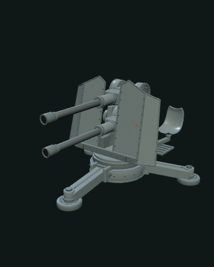
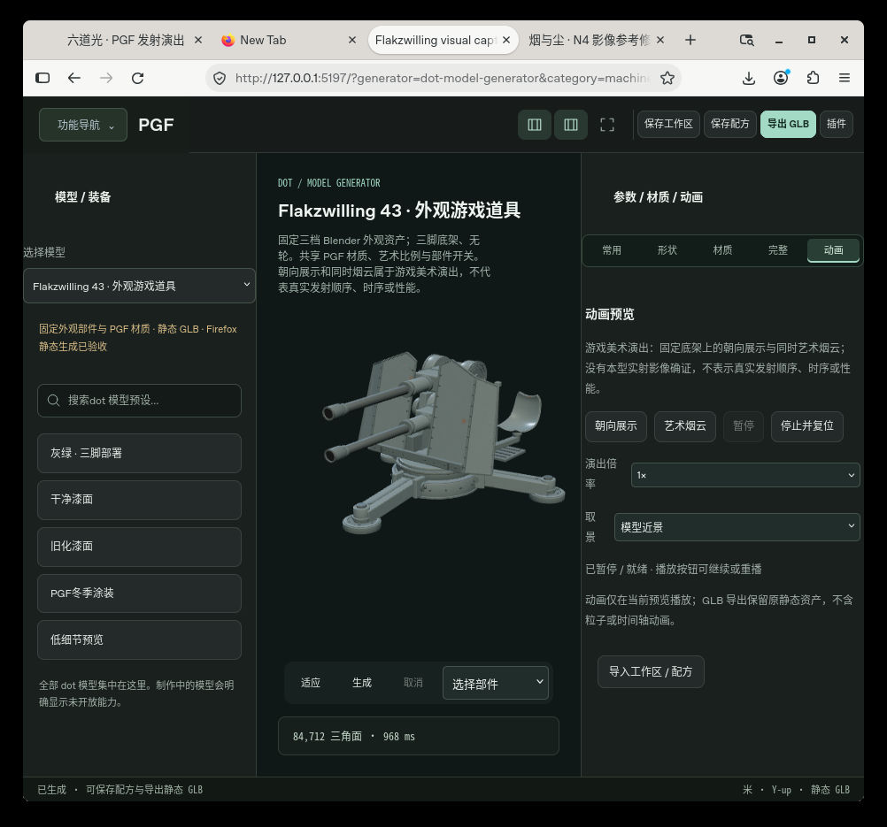

# Flakzwilling 43 exterior art

Original nonfunctional game prop interpreted from late-WWII vertically stacked twin silhouette and deployed tripod. Not an exact museum replica, weapon engineering model or manufacturing reference.

## F2 live baseline (1.1.0)
- Genuine Blender MCP 2.1.9 stdio authored geometry in Blender 4.3.2; original unchanged addon hash recorded in the production receipt, telemetry and integrations disabled
- Three pre-authored detail levels; source GLB files pinned by SHA256 in `model.mjs`
- PGF-owned static assembly with art scale, shield-width ratio, seven component toggles, deterministic surface seed, existing PGF material-kit metalFinishPixels PBR, with portable camouflage when selected
- Fixed tripod with no wheel/track model; two closed shallow front faces; no internal parts, ammunition, real firing simulation or ballistics
- Preview motion belongs to a separate host runtime; static GLB contains no animation clips

Single module-owned definition/schema/presets and automatic manifest discovery. Uses shared data workbench and Worker. No per-generator MCP core branching. `procedural:false`, `onlineRemodeling:false` are intentional: PGF reassembles authored geometry and modifies appearance, never claims to rebuild the Blender mesh online.

## Commands
`node --test modules/flakzwilling43-visual-prop/tests/adapter.test.mjs`
`node modules/flakzwilling43-visual-prop/tests/mcp-worker.mjs`
`node node_modules/vite/bin/vite.js build --config modules/flakzwilling43-visual-prop/tests/vite.config.mjs`

The first command validates actual AssetIR/GLB, textures, source identity, parts, scale, numeric boundaries, corrupted sources, cancellation and resource ownership. The second validates real shared ArtifactService discovery/description and isolated Worker generation; it is not a transport-session claim. Blender authoring separately has genuine MCP receipts. Browser verification is a separate integration gate.

Source concept sheets are original AI images. Third-party photographs were viewed for visual research only, not image-generation inputs, textures or packaged assets. See production reference brief for credits and uncertainty.

## F2 delivery and evidence

The F2 refinement adds continuous concave seat surfaces, rolled seat edges, shield perimeter reinforcement, layered closed cover faces, external tripod clamp caps and stepped foot pads. These are exterior art details only. The original F1 technical baseline is preserved in its recovery checkpoint.

Final review GLB: SHA256 `7e590a8fcf8f9e8bb8523801cfc7a838ea13a79722f4aacc735f767e1820008c`, 84,712 triangles, 304 meshes, three embedded 512×512 PBR textures. Final full-view review images are actual renders of this same exported PGF GLB after reimport, never the AI concept images.

`f2-surface.mjs` calls the existing `modules/material-kit/metal-finish.mjs` pixel function unchanged. Its provenance and parameter mappings are explicit; no new shader/baking system is introduced. The recovered snapshot contained no standalone license header for that project module, so this delivery does not relabel it as MIT or infer a third-party license.

F2 Node/GLTFLoader tests and independent Blender geometry/material-document reopening passed. Actual shared PGF ArtifactService/Worker and live browser acceptance remain separate gates. Until a browser report says otherwise, browser acceptance is NOT RUN.

## 真实 Firefox 渲染与统一工作台

[动作采样 GIF](../dot-model-generator/flakzwilling-evidence/Flakzwilling-F2-display-seek-preview.gif) · [烟云采样 GIF](../dot-model-generator/flakzwilling-evidence/Flakzwilling-F2-smoke-seek-preview.gif) · [本轮静态 GLB](../dot-model-generator/flakzwilling-evidence/Flakzwilling-F2-unified-export.glb)

图片来自已验收的统一工作台原 renderer。GIF 是**暂停 seek 采样**，不是连续实时时序录像；仅为游戏美术演出，不表示真实发射顺序、性能或弹道。静态 GLB 不含动作与粒子。
