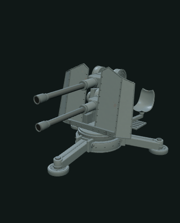

# Flakzwilling 43 预览艺术动画 R1 · F2最终资产回归

仅游戏美术演出，无本型实射影片确证。固定三脚底架，六个作者命名外观组以同相朝向摇转；上下外观锚点只定位克制烟云，使用一个同时艺术提示。不含发射顺序、实射时间、弹道、瞄准、后坐、内部机构或性能模拟，无轮/履带/行走。

## 接线

从 index.mjs 导入 createFlakzwillingVisualRuntime({object,scene,asset,invalidate,valid,config})。

- object 必须是已挂入 host scene 的实际 AssetHandle.object
- host 保留唯一 renderer/canvas/tick；每 tick 调用 update(dt)，dt 为非负有限秒数
- play('display') / play('smoke')；pause、reset、stop、seek(seconds)、setActive、dispose
- getters available / playing / duration；diagnostics() / status() / bounds()
- UI 文案“游戏美术演出”“朝向展示”“艺术烟云”，不称“影像参考开火”
- valid 只确认首次挂载，不把旧上传票据到期误当当前对象失效
- 先成功生成/挂载新资产，后 dispose 旧 runtime；失败编辑保留当前资产
- 隐藏页/路由暂停 host tick，并 setActive(false) 隐藏自有烟云；返回时 setActive(true)
- 离开/替换先 dispose runtime，再 dispose AssetHandle

## 资源与导出

只借用六个明确命名的外观组变换，不修改层级、顶点、geometry/material/texture 或 AssetIR。reset/dispose 恢复原始变换及 matrixAutoUpdate。烟云是 scene 下独立自有组，dispose 只释放自有粒子资源。导出始终走静态 AssetIR；动画和粒子不在 GLB 中。

所有艺术参数有边界：displayCycle 4–30、yawAmplitude 0–0.6、smokeDuration 3–8、32位整数seed；不是历史参数。作者确认本地 Y 向上、+Z 外观前向，全部三档合同一致。六组在同一原点，不做几何位置推断。

## 验证

node --test modules/flakzwilling43-visual-runtime/tests/*.test.mjs

actual.test.mjs 为实际三档作者 GLB、真实 PGF AssetIR、静态 GLB 字节比较和回读、真实 PGF 烟材质生命周期。runtime.test.mjs 是独立标注的合成 lifecycle fixtures。Canvas/ImageBitmap Node shim 仅用于对象验证，不证明浏览器渲染。浏览器接线/图像仍由工作台集成阶段验收。

当前共享恢复目录无 .git；已查询 CodeGraph 工具/索引，当前环境未提供。未执行 Git/GitHub 写入，只编辑本模块。

2026-10-12 最终回归：8/8通过，三档来源全部为 live F2 v1.1.0；逐个断言源GLB SHA、PGF generator version 与 stage。最终冻结PGF GLB 7e590a8fcf8f9e8bb8523801cfc7a838ea13a79722f4aacc735f767e1820008c 已实际读取、校验与节点回读。原先F1证据由本次F2证据替代，浏览器结果仍由工作台集成验收提供。

## Node 纹理警告纠正与独立解码

旧测试曾用 Object3D.toJSON 比较已挂载对象。Node 的 createImageBitmap 夹具只提供 width/height/close，不是浏览器 ImageBitmap，也没有 DataTexture 的 data 字段；Three Source.js serializeImage 因此发出 Unable to serialize Texture。3档×前后2次×3张图片=18次警告。此路径不参与静态GLB导出，但旧对象JSON不能证明纹理源未变。

现已移除带纹理对象的 toJSON 比较，改为对象、geometry、材质、texture、Source和图像严格身份比较，另比较不可变的节点变换/子层级、geometry属性/index字节SHA、材质颜色/数值/贴图引用、texture参数及真实编码PNG的SHA。没有屏蔽警告，也没有更改运行时代码。

新增 asset-evidence.mjs：直接解析实际GLB JSON/BIN块，取出嵌入PNG，以 @napi-rs/canvas 原生Skia独立解码，绕开PGF reader和bitmap夹具。三档和冻结最终GLB均验证3张真实图片、尺寸、像素变化、PNG与RGBA SHA和PBR材质引用。最终GLB三图均512×512，分别7633/21137/61201字节；ORM的AO红通道常量255，粗糙度/金属度通道有真实变化。详情在 actual-report.json。8/8测试通过，输出无纹理警告；这仍不是浏览器渲染证书。

## 已验收的 Firefox 预览采样

### 固定底架朝向展示

### 局部艺术烟云

[实际统一工作台截图](../dot-model-generator/flakzwilling-evidence/Flakzwilling-F2-unified-workbench.png) · [静态模型渲染](../dot-model-generator/flakzwilling-evidence/Flakzwilling-F2-static-viewport.png) · [本轮静态 GLB](../dot-model-generator/flakzwilling-evidence/Flakzwilling-F2-unified-export.glb)

以上 GIF 由真实 Firefox 的现有 renderer 在暂停后逐点 seek 采样，不是连续实时时序录像。只展示游戏美术动作与局部灰烟，不表达真实发射顺序、时序、射击性能或弹道；无弹丸、机械后坐或火球。静态 GLB 不导出动作、粒子或时间轴。模型近景与完整演出范围为独立取景选项。
