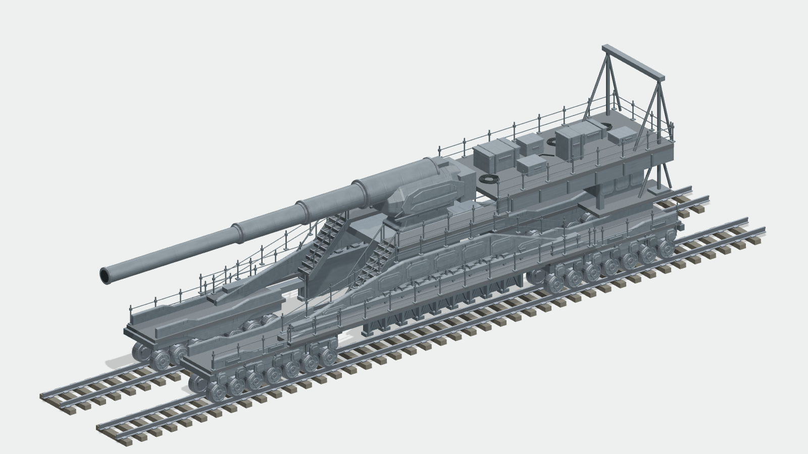

# 古斯塔夫风格 · 非功能性外观游戏道具

PGF 规则部件与真实 Blender MCP 外观原型组合的参数生成器。只还原可见轮廓、表层、平台与配色；不含内部机构、真实测量、制造参数或性能模拟。所有数字是未测量艺术坐标；PGF 的 meter 标记仅是交换格式约定。

## 实际渲染预览

G7 最终固定 GLB 的实际 Three.js 渲染。
同一模型的正交三视：[正视](evidence/final-three/gustav-visual-prop-final-front.png) · [侧视](evidence/final-three/gustav-visual-prop-final-side.png) · [俯视](evidence/final-three/gustav-visual-prop-final-top.png)。

## 已有组成
- PGF rule-kit：梁板、闭合长筒、装饰环、台面、栏杆连接、梯步、外表装饰
- PGF bridge 的公开 generateBridge：选择双轨道的四条钢轨、轨枕与扣件描述
- PGF curve-infrastructure 的公开 buildCurve：平台和坡道栏杆，禁用路灯
- Blender 4.3.2 经真实 stdio MCP：铁路金属轮外观、斜侧壳、端部侧壳、斜肩中央闭壳，以及分层轮面/侧盖/中央层板、普通箱盖/卷线、闭合阶梯底座、轮側罩板与折边梯侧板，共12种外观原型，低中高三套独立网格
- PGF 坦克 portable-vehicle-finish：漆面 BaseColor/Normal/ORM 与完整迷彩图案；裸钢车轮/轨道独立角色，不接受迷彩
- 共享 schema/defaults/presets、Worker、workbench、AssetIR、GLB 导出；无 MCP 专属分派

## 美术参数
seed 是顶层请求参数。params 仅含 detail、整体长/宽/高倍率、圆轮视觉倍率、框架厚重感、外壳长度倍率、铆钉密度、磨损、油漆/裸钢色、共享 camoPattern/camoEnvironment/camoScale 和轨道/栏杆/楼梯/铆钉/后平台/装饰箱开关。范围以 definition.mjs 的严格 schema 为唯一准则。

整体比例只改变车轮位置；56 个车轮各自保持统一缩放，不拉成椭圆。短车身与大圆轮组合会独立展开端部展示模块跨度，保持轮间正间隙和台面覆盖，不强挤相邻轮。轮缘与展示轨顶或地面接触；上部艺术层次按轮顶重新定位。low/medium/high 是显式生成档位，不宣称自动运行时 LOD。

已根据新增反馈完成 G4 外观细化与全部公开开关：独立轮面浮雕、中央和框架多层盖板、平台踏面、普通封闭箱和卷线。仍是风格化参数艺术外观，隐藏面与装饰节奏为艺术推测，不声称真实测绘或与参考逐项相同。验收记录见 evidence/。

## 合批与语义
同一个 owner 下同一种材质的静态叶网格安全合并。车轮保留独立节点。每个合并结果的 sourceParts 保留原名称、owner、source、appearanceRole 和 start/count 三角范围；通过 AssetIR metadata 与 GLB extras 传递。G7 为 1475→74 draws、1483→82 nodes、146,012 triangles 不变，逐部件 world float32 surface hash 完全相同，最大坐标误差 0。统计含展开后的56个轮实例，非仅原型计数。

## 复现
授权隔离依赖宿主在仓库旁 pgf-vehicle-test-deps；不改 package.json/lock。

node --loader ../pgf-vehicle-test-deps/loader.mjs --test modules/gustav-visual-prop/tests/core.test.mjs
node --loader ../pgf-vehicle-test-deps/loader.mjs dev/gustav-visual-prop-export.mjs medium
node --loader ../pgf-vehicle-test-deps/loader.mjs dev/gustav-visual-prop-worker-test.mjs
node --loader ../pgf-vehicle-test-deps/loader.mjs dev/gustav-visual-prop-surface-audit.mjs
node dev/gustav-visual-prop-preview.mjs

Blender 源脚本为 dev/gustav-visual-prop-blender-kit.py，调用说明见工作区 blender-mcp-local/README.md。调用脚本内只使用工作区绝对路径，不开外部资产服务，不改凭据，安全模式保留。运行回执位于 evidence/*mcp-receipt.json。

## 验收范围
Node 几何/UV/法线/非退化面、确定性、极值圆轮接触、资源隔离、实际 shared Worker、GLB 回读和 actual Blender MCP 是不同验收项，逐项记录。当前 PGF stdio MCP list/describe/generate/remove、完整锁定生产构建、真实 Firefox UI 已按最终差分执行，见 G7-browser-acceptance.json；PGF stdio与完整锁定生产构建未运行。独立 preview 使用可用 Vite 8.1.5 / Three 0.180.0 / canvas 1.0.9，不等同于仓库生产锁定依赖全构建。原始 G2b render 因超时且使用旧输入已标废弃，不作为成果图片。

## 参考和权利范围
输入图为用户提供，生成参考是艺术指导而非历史图纸；SOURCE-MATRIX.md 区分真实复用、MCP缺项与推测。无需下载第三方网格。桥梁公开模块已有上游归属说明保持不变。底部、隐藏面、重复数量与细装饰均为艺术推测。

## G7 几何细化收口（1.1.2）
默认中档146,012三角、74 draw、82节点、7材质、6贴图。低档48,332三角/69 draw，高档218,744三角/74 draw。三档预算70k/200k/360k，上限并非填满目标。13项正式测试和12个API/GLB变体、实际共享Worker均通过。

轮侧增加带层次的闭合外罩和连接条；中央底座为斜肩阶梯形闭壳；楼梯采用折边厚侧板，扶手在高度/轮倍率极值时仍连接实际平台立柱。所有部分都是非功能性外部艺术形状。

最终固定GLB为 evidence/gustav-G7-3e988dcd.glb，SHA256 3e988dcd4e60a72996030c23a58e54476a12ab08264ecc3cfa6308b968d54590。G6实际MCP hero及轮组、中央壳近景保留为形态审核历史；G7去除横纵栏交角两套重复立柱及派生脚垫/接头，共72冗余三角，外表轮廓未变。G7实际MCP短导入/保存/重开提供原生源链，最终清晰Three图与严格正交相机回执由Firefox实际UI输出。最终Firefox差分、实际GLB/recipe下载回导、4真实缩略图、1440/1600完整viewport均通过。G7清晰hero+严格三视在 evidence/final-three/，各有绑定固定GLB SHA的相机回执，详见 evidence/acceptance-status.json。

材质保留PGF路径；真实Blender专用烘焙候选按用户后续确认标记未采用，见 authoring/UNADOPTED-NATIVE-PBR.md，不会默认导入。未复用truck模型或表面。

独立预览启动脚本 dev/gustav-visual-prop-start-preview-v2.sh 使用回环127.0.0.1:5178，旧5177保留作基线。最终review提供可见hero/front/side/top按钮、PNG下载及绑定实际GLB SHA的正交相机JSON。三正交统一像素/艺术单位，top严格垂直向下。

## 交付边界与阶段
G7最终固定展示GLB为3e988dcd…，艺术seed gustav-art-1；实际工作台下载GLB为5ff4e0cc…，seed pgf-components-1，两者均146,012三角/74draw，下载配方已独立逐项对应。浏览器空闲/取消/释放的G4基线与G7差分证据分别标识，不冒充在G7重复测量。未运行PGF stdio生命周期、完整生产锁定构建、GIF与硬件GPU性能认证。

已确认历史阶段提交：G1 8502bed1deaa7ad13cd63f9e5c9cab3dd4e76183；G2 71d9364398f757c0e04eda2f54b12fdaa3ac0e7c；G3 49e48a78cde24521873c1555c092e658f731954e；G4 cfef12cdc4ee7ac5e836a4d7966701e97d4b0df1。G6形态审核与G7最终修复纳入最后独立冻结差分，最终commit需发布者确认，不在本源快照预填。
