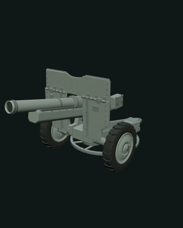
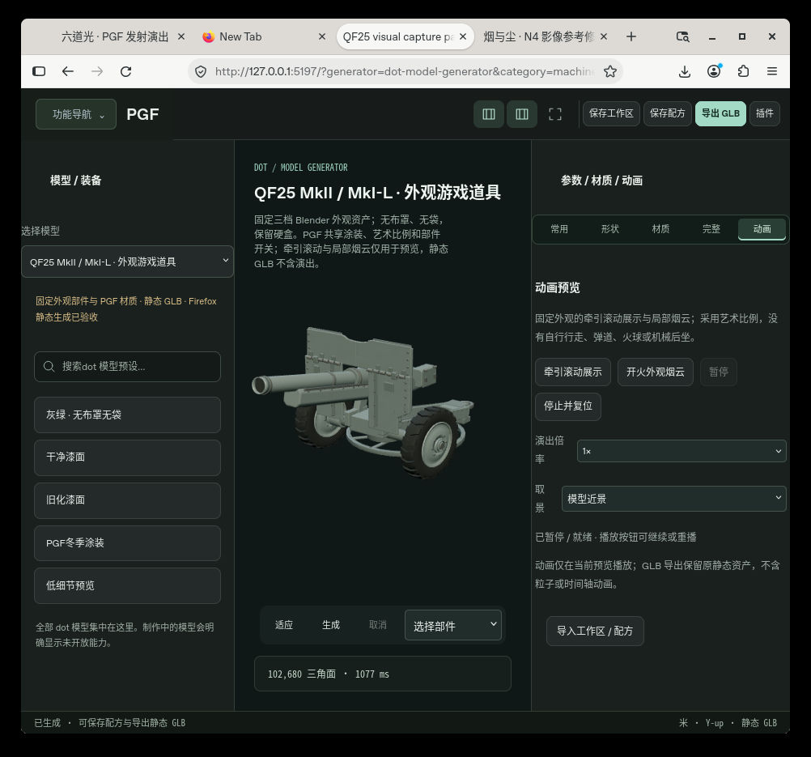

# QF25 MkII 外观资产 · PGF 适配

复用已验证的 Blender MCP 三档非功能游戏外观源资产，接入 PGF 的共享参数、Worker、材质与静态导出。炮口布罩和外部布袋不存在于源模型。

## 参数
detail 为 low/medium/high；统一 quality 请求覆盖 detail。artScale 为 .75–1.5 的整体艺术比例，wheelSpacing 为 .95–1.1 的轮距外观调整；并非实物测量。8 个独立部件开关包括左右轮、炮管外壳、盾板、炮架、尾架、平台和外饰。paintColor/roughness/weathering 与 PGF camoPattern/camoEnvironment/camoScale 使用现有 material-kit/metal-finish.mjs 的 metalFinishPixels 与既有 bakePgfCamo / bindVehicleCamouflage 实现（不含坦克面板网格）。seed 只驱动材质，不伪称在线 Blender 重建。

## 导出
静态 GLB 含实际可见几何、PBR、语义层级和配方；动画和粒子只由宿主预览。运行时合同保留 QF25_ROOT、独立两轮 pivot、浅暗端面和外观效果锚点；metadata.showCover 始终 false。隐藏所需部件时，动作绑定可能不可用。

## 已验证
10/10 Node 测试：源校验、三档面数、比例、8 部件全开关、seed 确定性、材质变化、输入边界、预算、HTTP/取消、GLTFLoader 异常/资源释放、GLB/实际PNG独立解码与共享Worker导出。PGF ArtifactService 自动发现、描述、隔离Worker生成及静态GLB重读通过。

## 尚未验证
Q1 统一 Firefox 51 项已冻结；Q2 1.1.0 尚待单独复验，不能沿用 Q1 结论。完整仓库 npm test/build 不适用于仅恢复依赖闭包的目录，未运行。PGF MCP transport server 未运行，恢复树缺少其锁版SDK；真实 Blender authoring 已另行通过 MCP stdio，并有独立回执。

## 验收命令
node --test modules/qf25-visual-prop/tests/adapter.test.mjs
node modules/qf25-visual-prop/tests/mcp-worker.mjs

本模块不修改共享 UI、旧模型模块或 MCP 分发代码。Q1 源几何已冻结保留。本版本 1.1.0 明确使用 Q2 新资产；low/medium/high 为 58,416 / 102,680 / 128,856 三角面。独立 GLB 实际 PNG 解码确认 base 为 sRGB、normal/ORM 为线性。

## 真实 Firefox 渲染与统一工作台

[动作采样 GIF](../dot-model-generator/qf25-q2-evidence/QF25-Q2-tow-seek-preview.gif) · [烟云采样 GIF](../dot-model-generator/qf25-q2-evidence/QF25-Q2-smoke-seek-preview.gif) · [本轮静态 GLB](../dot-model-generator/qf25-q2-evidence/QF25-Q2-unified-export.glb)

图片来自已验收的统一工作台原 renderer。GIF 是**暂停 seek 采样**，不是连续实时时序录像；仅为游戏美术演出，不表示真实发射顺序、性能或弹道。静态 GLB 不含动作与粒子。
