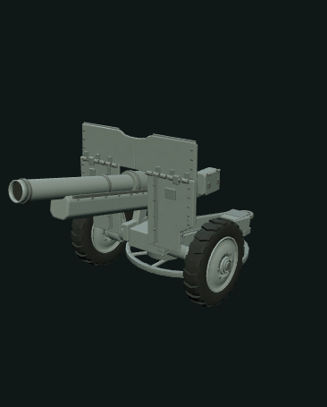

# QF25 外观预览 R3

仅游戏美术外观。艺术轮滚展示（不是自行行走或真实牵引姿态复现）与克制局部烟云。没有弹丸、弹道、火球、机械后坐、内部机构或真实性能模拟。

## 接入

使用既有 `createPluginPreview(container,onFrame,{animated:true,runtimeFactory:createQf25VisualRuntime})`，从本模块 `index.mjs` 导入factory。不新增renderer/canvas/RAF，不改旧模块或共享UI。播放命令只有 `tow` 与 `fire`，支持pause/seek/reset/setActive/dispose。宿主若要显示中文选项，请用“牵引滚动展示”“开火外观烟云”，不要写“自行行走”或“实测”。

本模块仅是可接入运行时，目前未注册到共享页面。真实浏览器操作必须由主任务安排唯一操作者。

## 部件与门控

作者已确认的GLB坐标与节点见 `binding.mjs`、`docs/interface-proposal.zh-CN.md`。最新默认为移除罩帽和外侧袋子；运行时只读此外观状态。

烟云必须同时满足：明确 `asset.metadata.showCover===false`（兼容recipe.params.showCover）；口端封面存在且可见；罩帽节点不存在或自身visible=false。没有显式状态、节点歧义、口端缺失或罩帽可见则拒绝。

## 所有权/导出

仅借用模型变换，reset/dispose恢复body位置和轮pivot quaternion；不dispose模型几何/材质。烟云根在宿主scene、模型根之外，只清理自有资源。静态GLB要从源AssetIR导出，不导出整个preview scene。

时间、距离、烟云大小、颜色是艺术设置。AWM黑白片只能支持烟尘外观参考，不能证明颜色、精确时序、火球或牵引过程。无帽口端是浅暗封闭面，不是可用炮膛。

## 检查

`node --test modules/qf25-visual-runtime/tests/*.test.mjs`

- runtime-fixture.test.mjs：合成Object3D合同；不是真实模型验收
- actual-glb.test.mjs：重载已存在实际Q1 GLB，hash记录于evidence；已通过作者去罩去袋medium源GLB 840f730f000e9cdd3df0fd0560c7ce926af1c6b22a65586f00a297dc754cf147；模型再次变化后必须再跑。可通过QF25_GLB指定已确认最终路径
- Node Canvas shim仅为PGF粒子资源测试，不代表WebGL shader/浏览器画质已验
- actual-asset.test.mjs：实际PGF low/medium/high生成、比例边界、运行时绑定、前后静态GLB字节及无FX节点检查已过
- 当前未完成真实PGF界面、浏览器/GIF验收

R3进度：10项节点fixture、2项真实GLB重载和2项实际PGF/静态导出测试通过。实际导出模型罩帽节点缺失、metadata.showCover=false、封面存在；10项fixture中包括旧帽态的负向门控，不能混称真实当前模型带帽。

## 影像来源及证据边界

AWM F01697，Attack on Waitavalo（1945-03-07，Alan Frederick Anderson）：https://www.awm.gov.au/collection/F01697 。研究工作实际检查馆页数字片的连续抽帧，含全片稀疏定位与炮镜头密集抽帧；不声称完整实时播放。馆页标记黑白无声实况、版权已过期/公有领域。该片只支持烟云观感参考，不认证此游戏模型的确切炮架铭牌/单件、1940–42姿态、真实时序或颜色。

PGF实际验收覆盖低(.75艺术缩放/.95轮距)、中、高(1.5艺术缩放/1.1轮距)。source→AssetIR→createAssetHandle的真实对象绑定与动作均通过，原源AssetIR静态GLB字节在轮滚/烟云前后不变，重读无preview FX。showBarrel=false时不能播放烟云。

## 已验收的 Firefox 预览采样

### 牵引滚动展示

### 局部艺术烟云

[实际统一工作台截图](../dot-model-generator/qf25-q2-evidence/QF25-Q2-unified-workbench.png) · [静态模型渲染](../dot-model-generator/qf25-q2-evidence/QF25-Q2-static-viewport.png) · [本轮静态 GLB](../dot-model-generator/qf25-q2-evidence/QF25-Q2-unified-export.glb)

以上 GIF 由真实 Firefox 的现有 renderer 在暂停后逐点 seek 采样，不是连续实时时序录像。只展示游戏美术动作与局部灰烟，不表达真实发射顺序、时序、射击性能或弹道；无弹丸、机械后坐或火球。静态 GLB 不导出动作、粒子或时间轴。模型近景与完整演出范围为独立取景选项。
