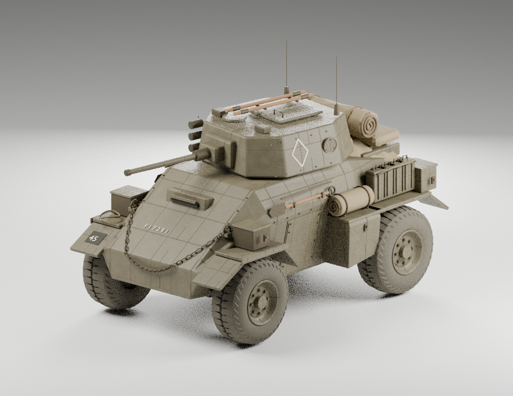

# 参考图四轮装甲车 · Blender 部件库重建

此模块根据新提供的棕色四轮装甲车照片重建：多面装甲车体、紧凑炮塔、白色空心菱形、前部垂链、后部油罐、卷布与绑带。不是 `armored-4x4` 悍马模块。模型只包含非功能性外观游戏美术；姿态参数仅旋转可见部件，不表示真实机械或武器工作原理。

## 实际渲染预览

最终原色 PGF GLB 经 Blender MCP 回导后的实际渲染，使用已接入的 PGF 坦克材质。

## 当前状态

实际 Blender MCP 已完成结构复核、次级外观、可携带 PBR、三档部件库和实际 PGF GLB 回读渲染。随后按新增要求接入现有坦克材质与 45 图案，17 项 Node/共享 Worker 回归、12 个实际 GLB 变体回读、全部画师覆盖与代表图案像素对照已通过。新增材质已在实际 Firefox Worker 中成功显示；四张实际 Three 预设缩略图和已列明的 Firefox 参数、下载回读、尺寸切换、取消与释放验收已完成；动态 GIF/录屏未执行，当前原生工具没有文档化录像接口。原色及沙漠的实际 PGF 导出 Blender 回读图已完成；最终状态以 `authoring/` 冻结清单为准。

## 同一条生成与导出路径

- Blender 离线制作带倒角、UV 和命名归属的部件，导出三档 GLB；编译工具把这些真实几何转换为浏览器/Node 通用的部件数据
- `core.mjs` 保持同步 `createReferenceArmoredCarModel(params, {seed})` 工厂。运行时组装部件并设置材质、视觉姿态和开关，不在滑块变化时启动 Blender
- `definition.mjs` 统一输出 AssetIR、配方、部件归属与 sockets；Worker、普通工作台和静态导出共享这一入口
- `review.js` 也使用 definition → AssetIR → 实际 GLB → GLTFLoader 回读，避免独立预览模型与导出模型不一致
- 所有几何采用近似视觉米制、Y-up、+Z 朝前；隐藏面和实际尺寸为推定

## 参数兼容

生成器 ID/版本保持 `reference-armored-car` / `1.1.0`；参数名与范围、四个预设 ID `reference` / `forward` / `clean` / `dusty` 保持兼容。

- `scale`：0.1–3
- `turretYaw`：−180°–180°；`gunElevation`：−8°–25°，均为外观旋转
- `paint`、`roughness`、`weathering`：漆色、粗糙度和可重复的材质风化
- `antennas`、`markings`：独立显示开关
- `camoPattern` / `camoEnvironment` / `camoScale`：新增现有坦克原色、随环境和 45 图案选择；环境为沙漠/丛林/雪地/城市，图案密度 0.5–2，默认 original/desert/1
- `detail`：保留 24–64 整数范围，明确映射三档 Blender 几何：24–35 低，36–55 中，56–64 高，不声称每个整数都会重新细分

此次视觉基准更新把默认炮塔角由 −35° 改为 −10°，默认漆色由 `#73795b` 改为棕色 `#827456`。`forward` 仍为 0°。已有配方显式保存的 −35° 或其他数值保持原义，不做重解释或隐式映射。视觉修订标识记录在导出元数据中。

## 材质与可编辑结构

装甲漆面直接复用现有坦克 `buildTurretSurfacePixels`，迷彩直接复用 `bakePgfCamo` 与原绑定器。薄共用接口 `modules/tank/src/portable-vehicle-finish.mjs` 为新增文件，不改变既有坦克。橡胶、裸钢、布、绑带、木材、镜片和菱形标记保持独立外观，不套迷彩。

默认 512px PBR：源 Blender GLB 为 20 张逐角色烘入颜色/数值的 PNG，PGF 为坦克装甲与附件两组共 6 张共享中性通道图乘可调材质因子。实际源与运行时 GLB 已逐像素取样验证，没有重复染色；最大线性色差 0.00352 为 8bit 烘图量化。MR 的 G 为粗糙度、B 为金属度，R 未用作 AO。当前 PGF 不保留 AO，不作相关承诺。完整来源、许可、像素方向和 Canvas 平台边界见 `authoring/tank-material-integration.md`。

保留 `hull`、`running-gear`、炮塔/炮管枢轴、四个轮子枢轴，以及前/后挡泥板、侧/后储物箱、舱盖和工具归属。放置 socket 加六个视觉姿态 socket 共七个。碰撞代理按 SDK 引用节点局部空间保存，0.5/2 倍比例验证不会重复缩放。分解预览不改变导出的装配状态。

三档为 62,683 / 107,826 / 141,358 三角形，69 个按相同归属与材质合批的模型 primitive、10 个材质角色；69 不是材质数量，也不是包含地面/阴影的实测浏览器 draw-call 总数。这是细节分档，不是远距离轻量 LOD。几何数据经无损 zlib 压缩，解码前后规范化 buffer SHA-256 相同。

## 来源与限制

原始照片的可见轮廓优先。AI 三视图只协助推定隐藏表面，前/顶视图并非测量对齐的真实正投影。输入文件哈希和说明在 `authoring/reference-config.json`。不使用旧白星照片、旧投射纹理或其历史相似度结果；不声称本次达到任何“90%”数值门槛。

旧 `reference-finish.mjs` 及对应图像资源是上一照片重建的遗留文件，新入口不加载它们。四张预设缩略图已由原生 Firefox 的实际 Three review 画布下载，参数逐项核对、像素查看及独立哈希通过；工作台使用静态资源路径，避免构建后的动态 URL 404。旧 `dev/reference-armored-car-*` 验收脚本中的白星照片/投射假设不适用于此次重建。新的验收位于模块内 `tests/` 及 `dev/reference-armored-car-blender-*`。

## 可重跑检查

    node --test modules/reference-armored-car/tests/*.test.mjs
    node dev/reference-armored-car-blender-compile.mjs
    node dev/reference-armored-car-blender-textures.mjs
    node dev/reference-armored-car-blender-preview.mjs

实际 Blender MCP 与 PGF stdio MCP 是不同链路：前者已实际运行；后者因本轮未扩展其服务端依赖而未运行，不能以 Node 验证替代该声明。

几何/Worker 检查要求 PGF 锁定的 Three.js 0.180.0；不能使用其他项目依赖替代并宣称通过。正式依赖是锁定版本的隔离安装；本次独立预览使用已有 Vite 8.1.5，未冒充完整项目 Vite 8.3.0 构建。

独立预览构建位于 PGF 源码之外的 `pgf-armored-preview`，不覆盖树项目或 PGF 主 dist。

Blender 源码在 `dev/reference-armored-car-blender-*.py`，可编辑源文件和中性三档 GLB 在 `assets/blender/`。实际 MCP 回执、结构检查及渲染证据在 `evidence/`；冻结阶段的精确文件哈希在 `authoring/stage-*-manifest.json`。

## 实际浏览器证据

`evidence/browser-acceptance.json` 记录真实 Firefox 157.0.1 的范围与限制，包含原生下载的 digital/urban/1.6 GLB 和配方。分解前后实际下载 GLB 字节完全一致；几何、UV、法线与装配变换也与同配方 Node 导出一致。跨浏览器/Node 的五张 PBR 图解码像素相同，迷彩色图最大差 7/255、平均绝对差 0.630/255，故不承诺跨 Canvas 引擎整文件字节一致。原色/沙漠 Node 与独立共享 Worker 传输已另作精确字节验证。

静置两秒零新增帧；释放后 Worker 终止、active=false、disposed=true、待处理RPC为0。69/6几何和纹理数在释放报告中是缓存诊断，不据此声称GPU分配计数归零。工作台69是资产primitive统计；独立真实GLB review渲染器测得70次绘制（含地面），不冒充工作台实测值。

源 `.blend` 容器已通过实际 Blender MCP 原生压缩与重开核验，tank-kit 从 13,045,141 降至 3,750,973 字节；所有对象、几何/UV、材质节点及打包图像内容相同。新版作者脚本默认 `compress=True`，原阶段审计不覆盖。最终接口范围、逐文件源码/材质绑定 SHA 与未运行项目见 `authoring/final-delivery.json`。
