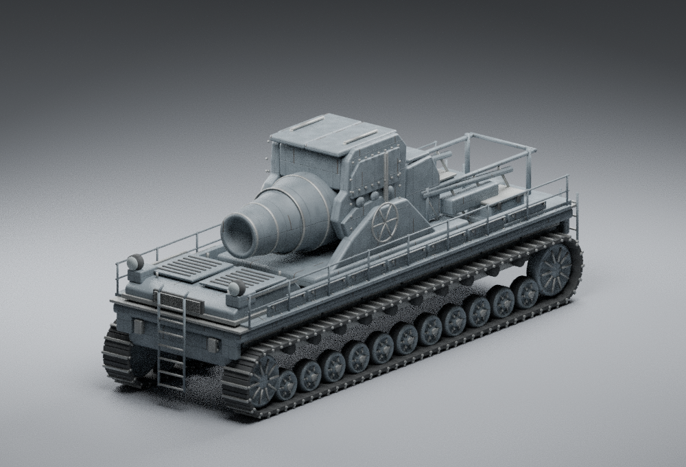

# 履带外观模型 · Blender MCP 重建 2.0.0

非功能性游戏外观模型。以用户原始灰色侧/顶/另一侧图为主，AI 生成前/侧/顶图为辅助；AI 前视、隐藏面和所有米制比例均为美术推测。不包含内部武器机构、弹药、弹道、火控或制造设计。

## 实际渲染预览

最终原色 PGF GLB 经 Blender MCP 回导后的 Cycles 渲染，使用已接入的 PGF 坦克材质。

## 当前验证状态

- 真实 stdio MCP → mcp-for-blender → Blender 4.3.2 构建、选中且 active-scene-only 的 GLB 导出、`.blend` 保存和 Cycles 渲染已执行
- 外形经过主要体块、侧面比例修正、次级外壳/轮缘/履带端帽/盖板/灯梯和材质阶段；没有以对象数量代替视觉审核
- 源 kit：81 个可复用网格原型、1,336 个命名节点、每侧 11 个路轮站位、4 个较高端轮；不是一个冻结大网格
- 源端和组装后均零退化三角面。high 109,900 面 / 21 个资产批次，standard 82,316 面 / 20 个资产批次（不含地面、阴影等额外渲染 pass），标准档少 25.1%
- Node 回归 15/15；9 种参数/材质的 prepareGenerator → Three.js → AssetIR → GLB → readGLB 均通过；原色和沙漠迷彩在真实独立 Worker 的生成/导出字节均与 Node 路径一致
- 实际 PGF GLB 已通过 MCP 再导入和渲染：`blender/evidence/pgf-tank-glb-reimport-hero.png`。此图与 GLB hash 的对应记录在 `pgf-tank-render-report.json`
- 实际 Firefox 已完成预设/参数/迷彩、下载回读、PC 视口、取消恢复与生命周期检查；context 修复与缩略图最终构建的差分烟测也已通过。本入口为两模块缩减 registry 的真实工作台，不等于完整应用生产构建
- 未给出数值相似度。历史 88% 属旧版人工描述，不是本版测量；旧视觉门禁保持，未用技术检查伪造视觉评分

## PGF 既有坦克材质

按用户追加要求，漆面直接调用共用的 `modules/tank/src/portable-vehicle-finish.mjs` 薄适配器。它复用现有 `buildTurretSurfacePixels` 与 `bakePgfCamo`/binder，不另造迷彩算法。

- 车体和上装漆面使用现有坦克 512px baseColor / normal / ORM 像素与角色因子
- 六种材料角色保留。轮带橡胶、裸钢、阴影金属和灯具继续使用 Blender 明确嵌入的 128px PBR 图像；迷彩仅覆盖漆面
- 新增 `paintColor`、`camoPattern`、`camoEnvironment`、`camoScale`。默认灰色 `#a2aaaf`，图案 `original`，环境 `desert`，密度 1；不自动把参考灰模型改成迷彩
- 支持坦克现有 45 个图案、`original` 和 `auto`，环境与密度沿用现有接口。原色、沙漠、数码、auto 城市与个性图案均有本模块实际 GLB 验证
- 运行时 15 张图像供六材料复用，材质、图案与参数进入配方/GLB；没有冒充 AO 支持，当前共享适配器不携带 AO

共用适配器的 45 图案与原坦克 headless 逐像素对照测试归它的作者维护；本模块测试自己的角色绑定、导出和 Worker。原色不需要 Canvas，完整图案的 Node 绘制使用项目已锁定的 `@napi-rs/canvas@1.0.9`。

## 参数兼容与组件

generator ID、原七个参数名和三个 preset ID 保持。版本仍为 2.0.0，材质/拓扑修订写入 `visualRevision=blender-clean-topology-tank-finish-1`。

唯一旧范围扩展：`elevation` 从 35–70° 扩展为 0–70°，新默认/reference 为 0°。已保存的 35–70 数值仍按原角度显示；inspection 仍为 35°，exploded 仍为 0.65。角度只是外观展示旋转。

八个 owner：chassis / running-gear / engine / platform / carriage / cradle / barrel / mechanisms。运行时组装 Blender 命名原型并按 owner/材料合批。长度调整重算履带鞋位置、纵向杆件与盖板比例；最短长度轻微等比缩小圆形路轮，保留轮间间隙。粗细、角度、栏杆、展开、细节档与磨损可独立变化。

实际 AssetIR 与 GLB 回读均保留 1 个 hull box collider、3 个展示 sockets 和八个 owner。GLB 只保存当前静态外观姿态。

## 可重建来源

输入图保存在 `blender/references/`：original-grey-side-top-opposite 为用户原图，generated-three-view 为 AI 辅助三视图；后者前视与比例不能当测量依据。

- `blender/build-kit.py`：主要外形；`build-revised-forms.py`：审核后侧面修正；`build-detailed-kit.py`：完整细节构建
- `apply-portable-materials.py`：六类灰色 PBR 图像；`portable-kit.blend` / `portable-kit.glb`：可编辑零件来源
- `clean-topology.py`：从历史保存文件去除轴心封帽零面积面；程序源 cap 已同时修正。保留所有有效三角形的位置/UV，split normal 的导出量化最大分量差小于 0.0001；见 `topology-surface-parity.json`
- `dev/tracked-mortar-blender-kit.mjs`：只用 Node 内置模块从实际 GLB 编译 `blender-kit.mjs`，运行时不读磁盘、不需要 Blender 服务
- `render-pgf-reimport.py`：最终 PGF 导出回读；`pgf-tank-reimport-verified.blend` 是带实际坦克材质的检查场景
- `render-pgf-tank-views.py`：固定侧/正/俯视检查相机
- `art-configuration.json`：坐标、参考优先级、推测边界与源 hash

MCP 回执与运行时/服务端/Blender 日志在 `blender/evidence/`。执行链为真实 `execute_blender_code`，仅用本地环回、关闭遥测、任务结束后停止服务。脚本 BASE 需指向当前模块目录。

## 正式测试与证据

- `node --test modules/tracked-mortar/tests/core.test.mjs`
- `node dev/tracked-mortar-blender-runtime.mjs`
- `node dev/tracked-mortar-blender-audit.mjs`
- `node dev/tracked-mortar-blender-kit.mjs modules/tracked-mortar/blender/portable-kit.glb`
- `node dev/tracked-mortar-blender-topology.mjs <清理前GLB> modules/tracked-mortar/blender/portable-kit.glb`

本次经用户批准在仓库外精确安装 PGF lock 的依赖，禁用安装脚本，未改 PGF package/lock。对应安装与 Canvas 实画素回执：`install-receipt.json`、`canvas-install-receipt.json`。最终契约修复日志：`context-node-tests.log`（15/15）、`context-runtime-tests.log`、`runtime-report.json`；旧 `tank-*-tests.log` 是前阶段记录。

默认最终导出 5,009,560 bytes，standard 3,770,296 bytes；15 textures、6 materials、30 nodes。生成时间以 `runtime-report.json` 的逐项实测为准，不把 Node 用时称为浏览器帧率。

`preview.html` 是实际 PGF 工作台/共享 Worker/预览器的独立验收入口；测试构建仅缩减 registry 元数据，不改生产 registry。此入口不等于全库生产构建通过。Blender 图为 20–48 samples，无降噪（此构建不含 OpenImageDenoise），颗粒属于采样噪声。

旧 `portable-pbr-*` 与 `pgf-glb-reimport-hero.png` 是坦克材质与零面积清理前的阶段证据，不绑定最终运行时 hash；最终图使用 `pgf-tank-*` 命名。

验收入口另提供可见的「验收状态」对话框，用于保存参数/资产统计、静置帧差和释放后状态；「预设图审核」进入独立 `review.html`，从本模块 canonical definition 生成、导出并用 Three.js 回读实际 GLB，再保存离线 PNG；真实工作台仍保留 RenderWorker，没有为截图改走 fallback。三张 500×380 PNG 已由实际 Firefox 下载、逐张查看并按 SHA 核对后接入原三个预设卡；不是调用 RenderWorker 不存在的同步截图接口。

### Blender 检查源压缩归档

为适配发布连接器的单文件请求上限，最终 `pgf-tank-reimport-verified.blend` 以 `pgf-tank-reimport-verified.blend.gz` 无损发布。`gzip -dk modules/tracked-mortar/blender/pgf-tank-reimport-verified.blend.gz` 可恢复原文件；字节数和 SHA256 校验见 `blender/evidence/blend-archive-receipt.json`。解压后再运行 `render-pgf-tank-views.py`，不用重建几何或材质。此归档不改变已验收 GLB 与渲染源。

### Node / MCP context 修复（checkpoint context-fix-v3）

`generate(request, context)` 现在正确处理 signal 与 budget：预先取消立即抛 AbortError；拥有的工作阶段之间让出事件循环并复查取消，失败或取消始终释放材料/纹理；基于真实导出实例、资产批次、节点、buffer/texture 字节与材质槽执行预算。非法或未知预算字段先拒绝。浏览器终止 Worker 不再被当成 Node/MCP 取消契约的替代。

新增回归后 15/15 通过，独立审查 R1 已复验关闭。`context-output-parity.json` 记录九种正常配置的 GLB 与 gzip-v2 逐字节完全相同，model.mjs 和 Blender kit 也保持同 hash，因此旧实际渲染仍绑定相同几何/材质和 GLB，不需伪造新图。原冻结清单保留，此修复作为明确的后续增量。

## Firefox 验收证据

`blender/evidence/browser/` 保存真实 Firefox 截图、原色/数字迷彩下载 GLB、配方、静置及释放 JSON；`browser-downloaded-glb-report.json` 为独立共享读者复验。GLB 有六个实际材料、15 个内嵌 PNG；共享 readGLB 额外加入一个未使用的默认材料，因此其回读列表有七项，实际使用角色仍为六项。

实际 RenderWorker 静置两秒的 frame 计数为 80 → 80；显式释放后 active=false、disposed=true、workerTerminated=true、renderRPC=0。缓存的几何/纹理计数未归零不被描述为活动 GPU 资源仍存在，也不伪称它们为零。独立 GLB review 的 frameCalls=22 含地面，工作台资产批次 21 不是硬件帧率或完整渲染 pass 认证。

浏览器下载用 `node dev/tracked-mortar-blender-browser-artifacts.mjs modules/tracked-mortar/blender/evidence/browser` 重查。需要项目锁定依赖；本次外置安装通过隔离 ESM loader 解析，未变更项目 package/lock。Vite 构建使用已有 8.1.5（项目期望 8.3.0），运行时为准确 Three.js r180，差异已记录。没有运行完整全应用 build、硬件性能认证或产品 GIF 录制。950px 视口模型完整可见，专注模式可放大；1440 虚拟视口的截图受物理 1364 屏宽限制，不称整屏 1440 截图。

最终 Firefox 包已通过三预设卡、拾色器/hex、参数页滚到底、取消保留后重新生成及 GLB 下载烟测。`tracked-mortar(2).glb` 与修复前默认浏览器下载的 5,007,328 bytes 和 SHA256 完全相同；它的种子为 `pgf-components-1`，与上文 Node 固定测试种子的 5,009,560-byte 文件应区分。完整范围与未执行项在 `browser/mortar-qa-progress.json`；本次没有以浏览器取消取代 Node/MCP signal 契约。
