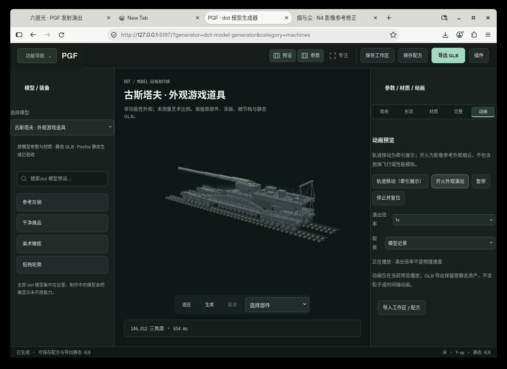
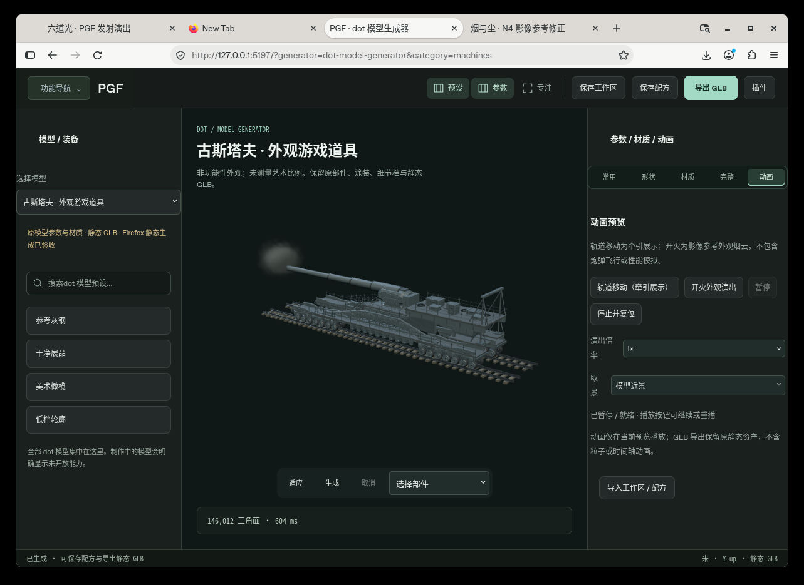
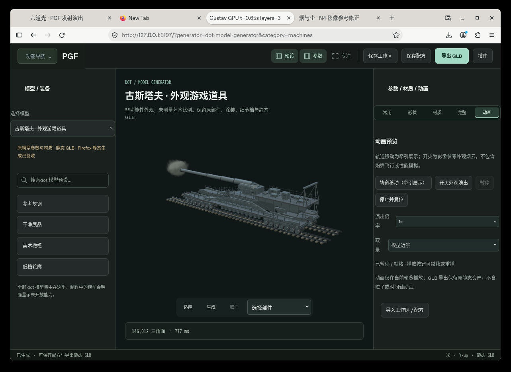
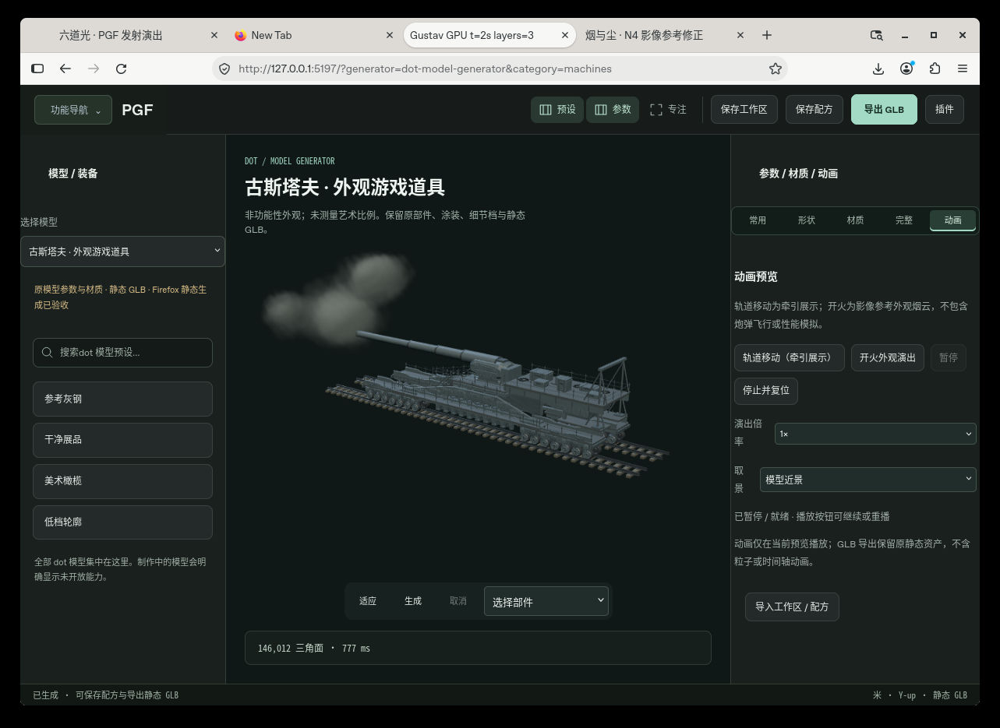
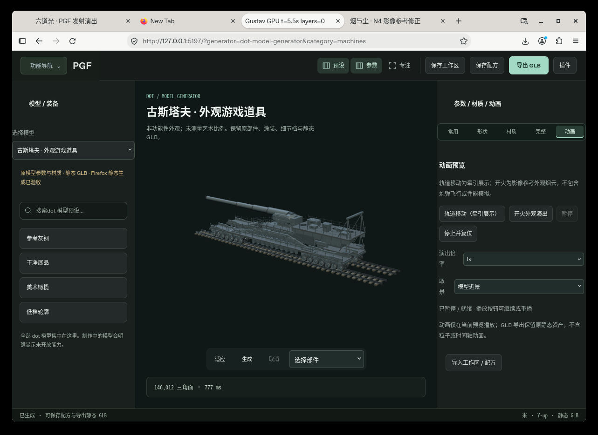

# 古斯塔夫影像参考开火外观 · F2 视觉修正

此模块是现有 PGF 预览的附加运行时，不是生成器或独立画布。当前只接 `gustav-visual-prop`。本轮修正了单一软球烟云，在真实统一 Firefox 的相同机位、相同艺术时间 2 秒画面中，已确认多瓣轮廓、浓淡层次与可读的模型主体。连续 22 帧实录已逐帧复核，专项 Node 10/10、整合 Node 89/89、实际 Firefox 宿主回归 105/105 全部通过。

## 可见参考与范围

已研究 [Periscope 40884 官方目录](https://stock.periscopefilm.com/40884-world-war-ii-german-newsreel-siege-of-sevastopol-schwerer-gustav-gun-1942-eastern-front/) 及 [档案馆公开副本](https://archive.org/details/40884takingsevastopilisthestrongestgestureintheworldgermanfilmmosvwr) 中的铁路炮片段。可见局部亮团、厚重多瓣烟云、遮挡与薄余烟；切镜头不能用作机械回动或真实射击时序证据。目录归属不等于每个镜头均独立确证，黑白片不能直接证明颜色。

本次只实现局部短亮部和较厚、不规则、向外扩开的烟云。一个艺术提示通过同点出生并连续扩开、不同大小与浓度的三组重叠云层表现，不表示三次真实开火；仍保留 PGF 体积粒子的柔边风格。没有长期发光弹体、火箭长尾、炮管回动、装填机构、真实性能或操作序列。色调、倍率和演出时长全部是艺术预览设置。第三方影片与抽帧不随包分发，完整原创来源说明见 [研究说明](docs/PGF-legacy-visual-research.zh-CN.md)。

## 复用与接口

- 直接复用 `modules/combat-fx/runtime/tank-shot-effects.mjs`、`visual-effects-config.mjs` 及原体积粒子 shader，没有修改共享 FX
- 只读 `opaque-front-recess` 封闭外观端面，从真实 Three 层级和 matrixWorld 计算视觉附着点，适配 AssetIR 的 Group→Mesh 包装与外观比例变化
- 输入 `{scene, object, asset, assetId?, invalidate?, valid?, config?}`；`valid` 只检查绑定起始有效性，后续参数编辑保留的已完成资产不会误销毁
- 导出 `createVehicleFirePreview`、`vehicleFireCapabilities`、`FIRE_DEFAULTS`
- 运行时 `playing`、`play('fire')`、`pause()`、`seek(seconds)`、`update(dt)`、`dispose()`；另有 `reset/stop/setActive/setSpeed/bounds/diagnostics`
- 暂停后 play 恢复；其他状态 play 从头重播。seek 按当前模型姿态确定视觉出生点，用固定步长和 seed 重建，最终状态暂停或保持原播放态
- 宿主唯一 tick 建议 `motion.update(dt)` 后 `fire.update(dt)`；运动和开火按钮分别控制。模块没有 renderer、RAF、timer 或事件监听
- 每次视觉烟云出生时取当前模型位置；云生成后保留在场景中，不随模型移动粘着漂移
- 当前能力仅古斯塔夫 `fire=true`。参考装甲车、履带模型仍等待各自适配；通信设备架越野车与柴油机车不增添武器

## 所有权和导出

资产、原材质、原几何和静态 AssetIR 全部借用只读。只创建并释放自己的 FX root 和原 PGF 特效资源。动画不写入静态 GLB；测试实际证明预览前后导出字节不变。原模型、N4 冻结和其他资产源码没有改动。

## 检查

```sh
node --test modules/vehicle-fire-preview/tests/*.test.mjs
```

测试使用真实原生成器→AssetIR→Three→PGF 特效对象。Node 的像素解码与 Canvas 是明确的测试替身，不证明 GPU shader 或最终视觉。覆盖锚点、不同外观比例、暂停/恢复、inactive、重播、seek、seed、固定步长、艺术倍率、移动后的锚点、资源所有权、重复 dispose、无效输入与静态 GLB 字节一致。

F2 专项 Node 测试为 10 项。GPU 与统一宿主检查另行记录，不能把 Node 的测试替身当作真实浏览器渲染。具体检查范围、实际原生帧及连续实录见 `evidence/` 与 `receipt.json`。视觉差异与来源限制见 [F2 差异说明](docs/F2-visual-delta.zh-CN.md)。

确定性边界：固定姿态、相同 seed 的重播和不同帧时间分块已验证一致。若同时播放车辆移动，宿主先更新整帧移动再更新开火，视觉出生点采样可能随帧分块略有变化；不承诺移动联动中的跨帧严格一致性。

## 实际 Firefox 证据

下图与 GIF 来自原 PGF 统一预览的真实浏览器画面，不是合成效果图。GIF 为连续播放采样，约每 0.3 秒一帧；它证明烟云出生、扩开和消散，不能保证拍到极短亮部。软件 WebGL 环境的播放速度不代表用户本机硬件性能。



修正前，相同机位与艺术时间 2 秒：



修正后，艺术时间 0.65 / 2 / 5.5 秒。标签页时间由实际运行诊断读回：





自动测试与人工视觉分别记入 [验收记录](evidence/firefox/visual-review.json)。共享 Three Sprite 几何缓存预热后保留 1 份、反复切换不增长；不能把这项说成 renderer 几何计数归零。完整宿主报告另外验证自有粒子、纹理、事件与最终上下文释放。
